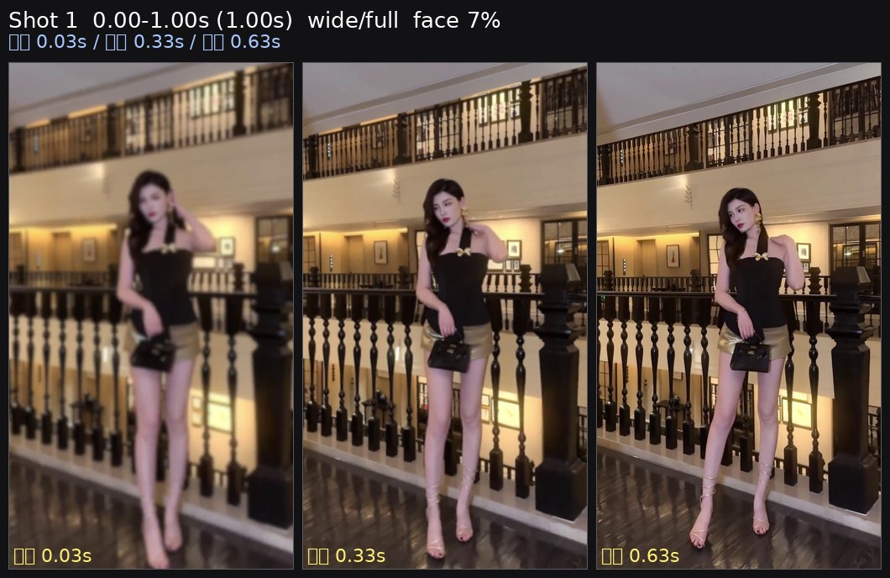
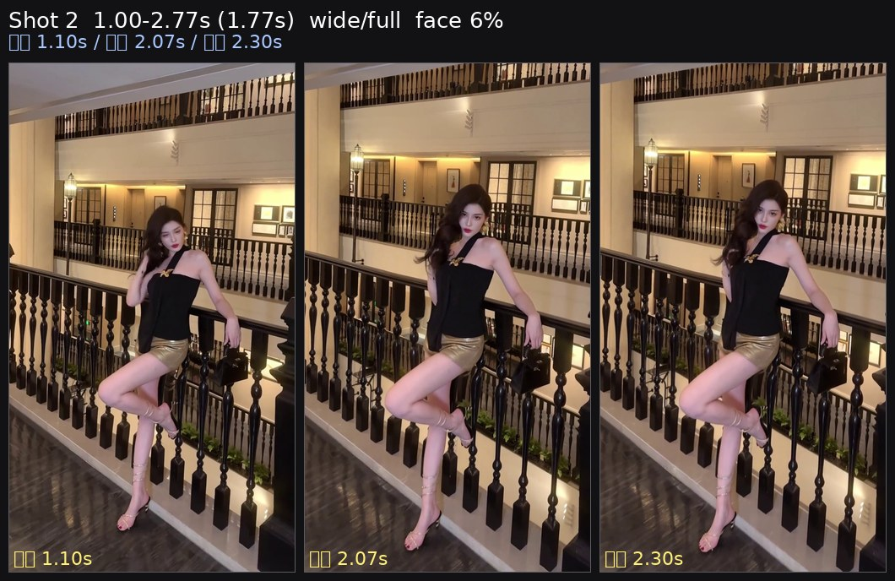
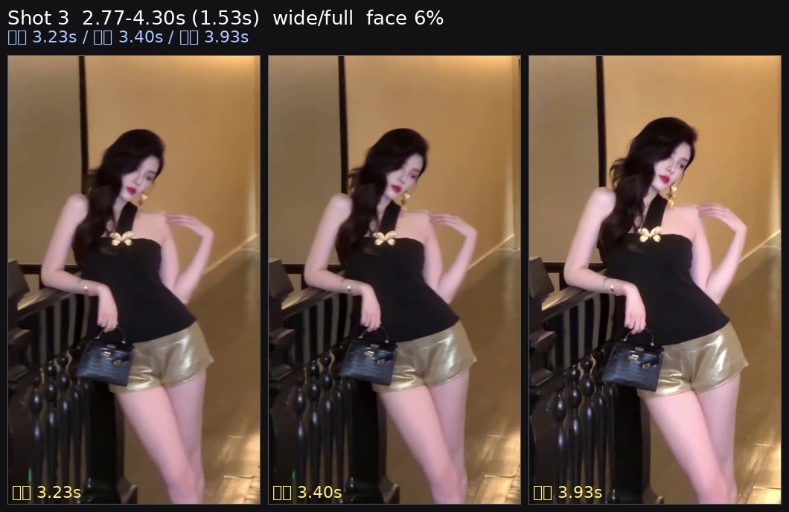
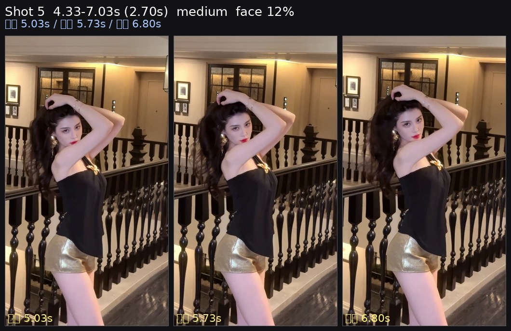

<video src="source.mp4" controls preload="metadata" width="270"></video>

[源视频 source](source.mp4) · 7.0s · 1080×1920 · 30fps

# 短视频逐帧拆解：linlin 街拍1

以下数字来自逐帧测量；镜头意图、人物动作和具体器材属于复刻建议。原始视频：`/tmp/lichun/short/linlin 街拍1.mp4`。

## 一眼可复刻的配方

| 项目 | 测量结果 | 复刻建议 |
|---|---:|---|
| 时长 / 剪辑 | 7.034s / 5 个镜头 | 保留 1 个约 0.03s 闪切，最后留约 2.70s 长镜头 |
| 镜头长度 | 1.00 / 1.77 / 1.53 / 0.03 / 2.70s | 前三段约 1–2s，闪切后用 2.7s 落地 |
| 画幅 / 帧率 | 1080×1920，竖幅，30fps | 竖幅 9:16，30p；快动镜头仍保持约 1/60 |
| 景别 | 3 个 wide/full（脸高 6.4–6.9%），1 个 medium（12.3%） | 前段用全身/宽景，最后切到中景 |
| 人脸位置 | x 约 39–58%，y 约 28–73% | 宽景允许头部上下跳位；中景保持 x 约 40%、y 约 33% |
| 运动 | 全局相位响应 0.91–0.97；第 5 镜头 8.8→2.0 | 第 5 镜头做“运动进入、最后 0.3–0.5s 稳住” |
| 主体分离 | 脸比背景亮 +0.57 stops；比衣服/头发亮 +1.31 stops | 让主体亮于环境，衣物保持偏暗 |
| 光比 / 方向 | key-fill 0.19 stops，约 1:1.1；画面右侧更亮的帧占 88% | 大而近的柔光源放在画面右侧、接近镜头轴 |
| 面部曝光 | 146/255（57%，+1.67 stops） | Rec.709 以脸部 55–60 IRE 为起点，斑马线约 70 |
| 反差 / 黑白点 | luma 中位附近 104；clip_hi 2.2%，clip_lo 1.2% | 保留少量高光溢出和压黑，不要把画面拉平 |
| 色彩 | chroma 17.9；黄色占高饱和像素 98.6%，R−B 从阴影 +12.7 到高光 +60.6 | 中等饱和、整体偏暖黄橙；阴影不要强行推青 |
| 音乐 / 节拍 | 90.7 BPM，0.662s/拍；剪辑与 onset 中位偏差 0.399s | 按乐句切，不必每一拍切；闪切作为重音标点 |

## 器材未知时的起始设置

这些是根据画面测量给出的起点，不是原视频器材的识别结果。

| 部分 | 起始设置 |
|---|---|
| 机身 | 竖拍 9:16，30p；快门 1/60；手动白平衡先从 5000–5600K 试拍 |
| 镜头 | 宽景用 35mm 全画幅等效；最后中景可用 35–50mm 等效。若是手机，先用 1×主摄并通过距离调整，不要数码变焦 |
| 光圈 / ISO | 光圈先 f/2.8–f/4；ISO 以脸部 55–60 IRE 为准，不用固定 ISO 硬套 |
| 对焦 | 人脸/眼部 AF；最后镜头保持主体在画面左中区域，避免背景亮点抢焦 |
| 稳定器 | 纯水平移动用 PF；带明显俯仰用 PTF；第 5 镜头的进入后落稳可用 Lock 或 PTF 高平滑 |
| 光源 | 90cm 以上柔光箱或窗光，画面右侧、接近镜头轴，略高于眼睛；从 20–30% 功率开始，再用斑马校准 |

## 镜头表

| # | 时间 / 时长 | 实测景别 | 焦段起点（全画幅等效） | 距离起点 | 稳定器 | 复刻动作 |
|---:|---|---|---|---|---|---|
| 1 | 0.00–1.00s / 1.00s | wide/full，脸 7.1→7.0% | 35mm | 约 2.8–3.3m | PTF，轻微上移/左移 | 从较稳状态进入运动，保留宽景 |
| 2 | 1.00–2.77s / 1.77s | wide/full，脸 6.3→7.3% | 35mm | 约 2.7–3.5m | PTF，右移并下压 | 主体位置基本不变，动作保持连续 |
| 3 | 2.77–4.30s / 1.53s | wide/full，脸 7.7→6.1% | 35mm | 约 2.5–3.6m | PF，左移 | 保持宽景，左移量明显于其他宽景 |
| 4 | 4.30–4.33s / 0.03s | 单帧闪切，无脸 | — | — | — | 只作为视觉标点，不要当成可拍长镜头 |
| 5 | 4.33–7.03s / 2.70s | medium，脸 12.3→12.6% | 35–50mm | 35mm 约 1.6m；50mm 约 2.3m | PTF 或 Lock | 运动进入，最后 0.3–0.5s 稳住；主体略偏画面左侧 |

### 镜头 1 · 0.00–1.00s · wide/full · 开场运动



实测：脸高 7.1%→7.0%，距离变化 -2%，头部中心 x 50%→53%、y 28%→30%；运动量 4.4→7.1，趋势为 `settle→move`。相位响应 0.95，估计为轻微左移、上移；方向仍应以现场取景复核。

| 项目 | 建议 |
|---|---|
| 焦段 / 光圈 / 快门 / ISO | 35mm 等效 / f/2.8–f/4 / 1/60 / ISO 以脸部斑马校准 |
| 距离 | 约 2.8–3.3m，保持宽景 |
| 稳定器 | PTF；高平滑，动作幅度小 |
| 光线 | 画面右侧柔光，先从 20–30% 功率试拍 |
| 关键点 | 不要一开始就大幅推进；让运动在镜头后半段出现 |

### 镜头 2 · 1.00–2.77s · wide/full · 右移下压



实测：脸高 6.3%→7.3%，距离变化 +15%，头部中心 x 58%→58%、y 33%→28%；相位响应 0.91，估计为轻微右移、下压。运动量 6.4→8.6，主体与机位运动可能叠加，复刻时优先保持主体尺寸稳定。

| 项目 | 建议 |
|---|---|
| 焦段 / 光圈 / 快门 / ISO | 35mm 等效 / f/2.8–f/4 / 1/60 / ISO 现场校准 |
| 距离 | 约 2.7–3.5m，允许靠近约 15% |
| 稳定器 | PTF；下压速度慢，避免突然点头 |
| 光线 | 右侧柔光保持不换边 |
| 关键点 | x 位置几乎不变，靠机位/距离变化制造节奏 |

### 镜头 3 · 2.77–4.30s · wide/full · 左移



实测：脸高 7.7%→6.1%，距离变化 -20%，头部中心 x 48%→55%、y 71%→73%；相位响应 0.97，估计为明显左移，俯仰量接近零。运动量 2.9→2.4，整体较稳。

| 项目 | 建议 |
|---|---|
| 焦段 / 光圈 / 快门 / ISO | 35mm 等效 / f/2.8–f/4 / 1/60 / ISO 现场校准 |
| 距离 | 约 2.5–3.6m，主体逐渐变小 |
| 稳定器 | PF；水平线保持平直 |
| 光线 | 右侧柔光，不追着主体换边 |
| 关键点 | 这是宽景里横向运动最明显的一段，移动要连续、不要抖腕 |

### 镜头 4 · 4.30–4.33s · 单帧闪切

这是一个测得的 1 帧镜头，持续约 0.033s、无可测人脸，亮度 186/255。它更像剪辑标点；拍摄时可用亮色背景、反光或快速遮挡制造同类闪切，避免把它误当作完整镜头。

### 镜头 5 · 4.33–7.03s · medium · 运动后落稳



实测：脸高 12.3%→12.6%，距离变化 +3%，头部中心 x 39%→41%、y 34%→32%；运动量 8.8→2.0，趋势为 `move→settle`，相位响应 0.94，估计为轻微右移、下压后落稳。

| 项目 | 建议 |
|---|---|
| 焦段 / 光圈 / 快门 / ISO | 35–50mm 等效 / f/2.8–f/4 / 1/60 / ISO 现场校准 |
| 距离 | 35mm 约 1.6m，50mm 约 2.3m；保持脸约 12%画高 |
| 稳定器 | PTF 或 Lock；最后 0.3–0.5s 锁住 |
| 光线 | 右侧柔光；主体比背景高约 0.6 stop |
| 关键点 | 进入时允许较大运动，落点必须干净，给剪辑一个稳定结尾 |

## 灯光拆解与校准

测量显示脸部平均 146/255（57%），背景 100/255；主体比背景高约 0.57 stop，脸部比衣服/头发高约 1.31 stop。左右脸差仅 0.19 stop，接近 1:1.1 的大柔光；右侧更亮的帧占 88%，所以整条复刻应把主光固定在画面右侧。上下差 +0.08 stop，接近眼平光；头发比脸暗 1.30 stop，未测到稳定轮廓光。高光面积 6.99%，说明可能有小而亮的反光/硬点，不能只用“完全柔光”解释。

```text
        环境/背景（中位约 100/255）
                    ↑
        [柔光箱/窗光]  →  人物  →  摄影机
          画面右侧、接近镜头轴，略高于眼睛
```

5 分钟校准：

1. 先按 35mm 等效、1/60、f/2.8–f/4 架位，人物离背景尽量留出距离。
2. 柔光源放在人物画面右侧 30–45°，从 20–30% 功率开始。
3. 调整到脸部约 55–60 IRE；确认背景中位比脸低约 0.5–0.7 stop。
4. 观察脸部左右差是否维持在 0.2 stop 左右；若超过 0.6 stop，加白墙/小反光板，不要把主光换到左侧。
5. 保留少量高光反射，但不要让大面积脸部超过 70 IRE；最后用第 5 镜头测试“运动进入→落稳”。

无灯环境：优先利用画面右侧的商店窗、橱窗或街灯作为主光；若主体不够亮，先靠近光源而不是立刻提高 ISO。混合环境下可把白平衡设在主光色温下方约 300–500K，让人物略暖、环境保留冷感；这是复刻建议，不是原视频的确定设置。

## 节奏与调色

音频 BPM 为 90.7，平均每拍 0.662s。镜头长度对应约 1.51、2.67、2.32、0.05、4.08 拍；只有 25% 剪辑点落在 onset ±60ms 内，剪辑点与最近 onset 的中位偏差 0.399s。因此复刻时按乐句和画面动作切，不要机械地每拍一刀；4.30s 的闪切负责重音，随后让第 5 镜头完整承接约 4 拍。

色彩测量为中等饱和（chroma 17.9），高饱和区域几乎全是黄色（98.6%），从阴影到高光 R−B 为 +12.7→+60.6。建议：

- 基础饱和度保持中等，不要套高饱和橙 teal 预设；
- 阴影保留暖黄，避免把阴影推成青色；
- 中高光向暖黄橙轻推，优先保护肤色；
- 黑位允许约 1.2% 压黑，高光允许约 2.2% 小面积溢出；
- 背景锐度不要当成景深证据：脸/背景锐度比仅 0.49，可能包含运动模糊或对焦差异，不建议为了复刻强行上超大光圈。

## 复刻检查表

| 看到的问题 | 可能原因 | 修正 |
|---|---|---|
| 人物不够突出 | 脸-背景差小于约 0.5 stop | 让右侧主光更近，降低功率并控制溢光 |
| 画面左右光感跳变 | 主光在镜头间换边 | 固定画面右侧主光，填充只做微调 |
| 宽景拍成中景 | 脸高超过约 10% | 后退或换更宽的等效焦段，先锁住脸高 6–7% |
| 最后一镜头没有“落地” | 运动一直持续到切点 | 最后 0.3–0.5s 停住，给剪辑稳定尾帧 |
| 闪切看起来拖沓 | 闪切超过 1 帧 | 保持约 0.03s，或用 1 拍以内的亮色插入 |
| 画面太冷或太青 | 阴影青色过量 | 先恢复暖黄，再微调高光，不要强行 teal-orange |
| 背景虚化过度 | 把锐度比误读成景深 | 保持主体亮度分离，优先校准光比和运动模糊 |

## 数据来源

- `.agents/skills/short-video-analysis/scripts/analyze.py all`：probe、cuts、frames、grade、audio、light、shots。
- `.agents/skills/short-video-analysis/scripts/make_strips.py`：代表帧与逐镜头三联条带；本次对单帧闪切使用临时保护副本，仅为避免重复补帧循环，原技能文件未修改。
