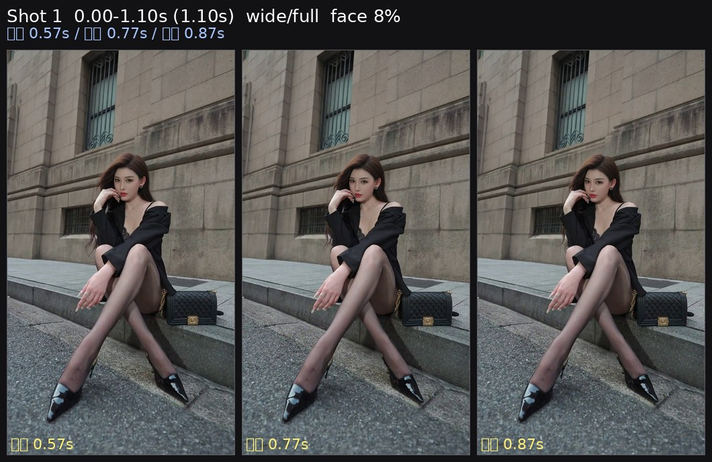
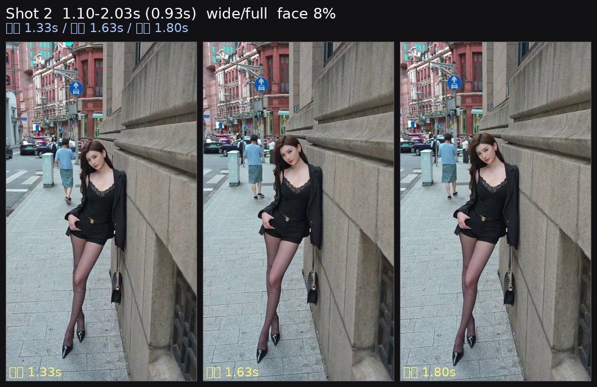
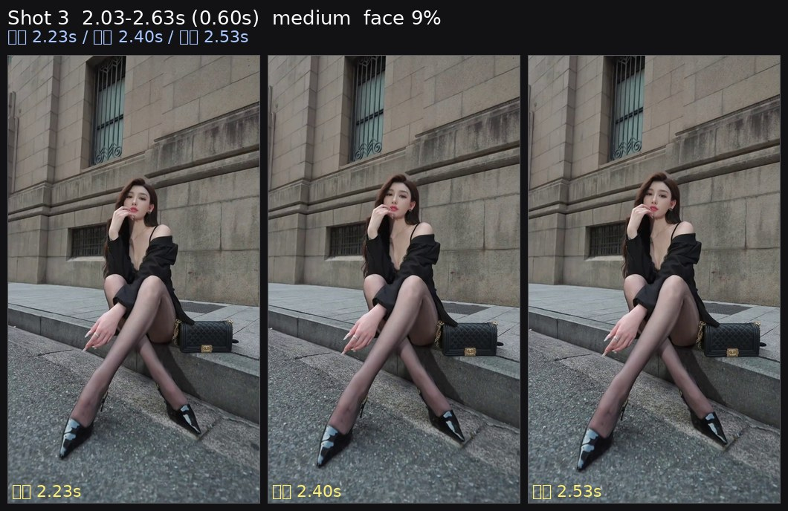
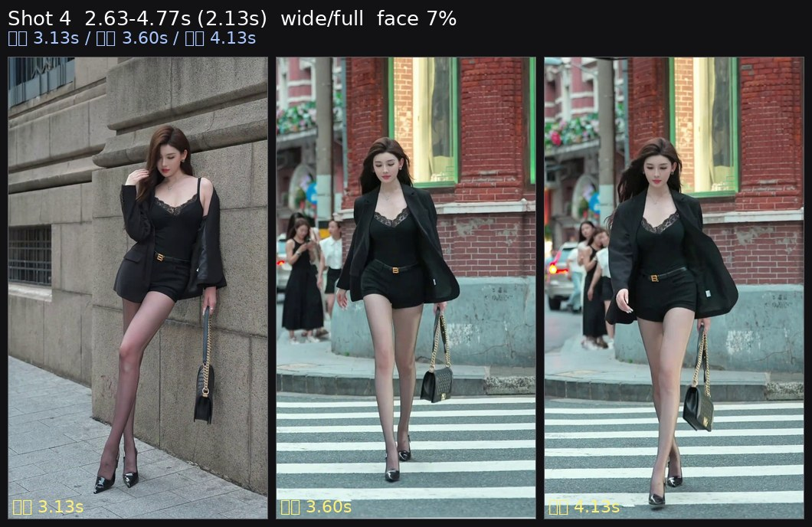
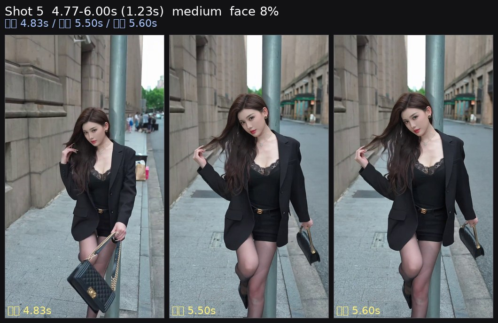
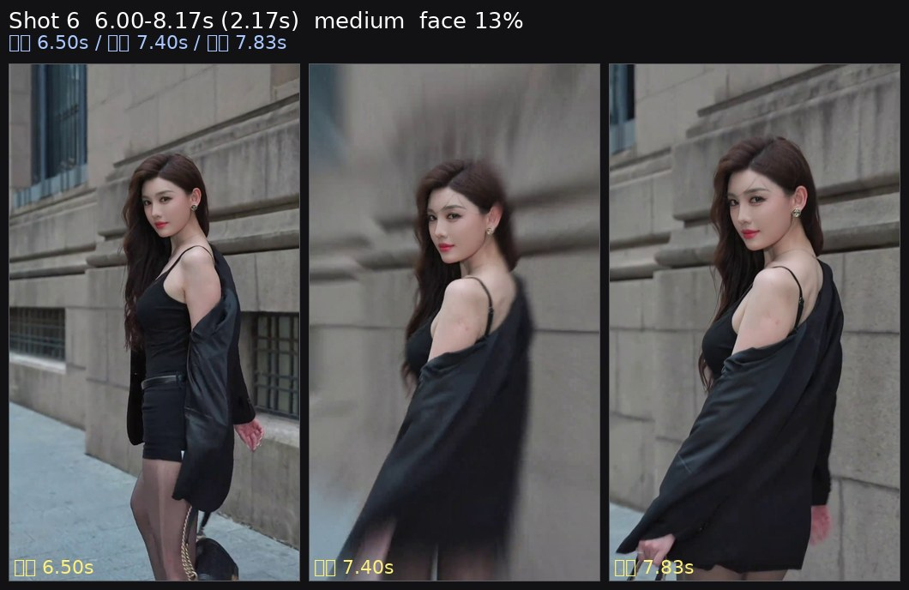
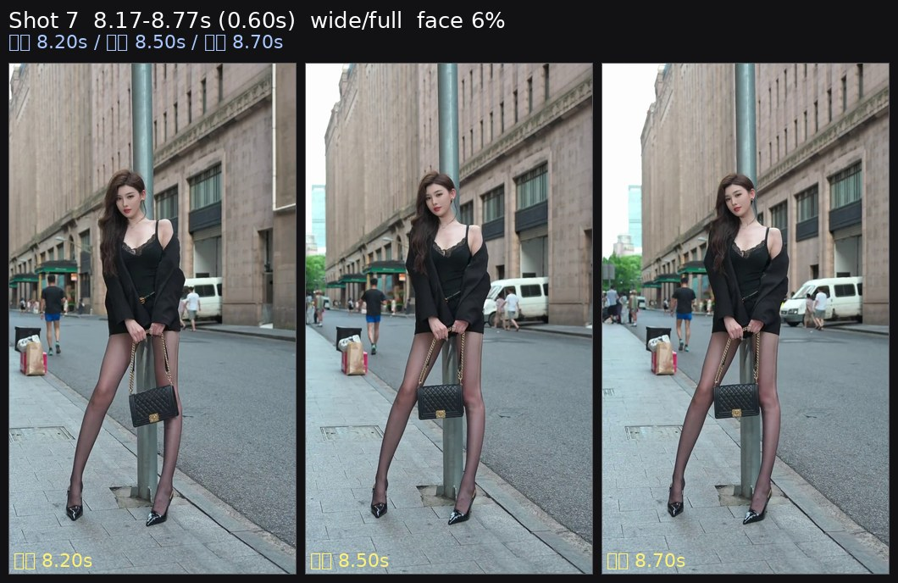
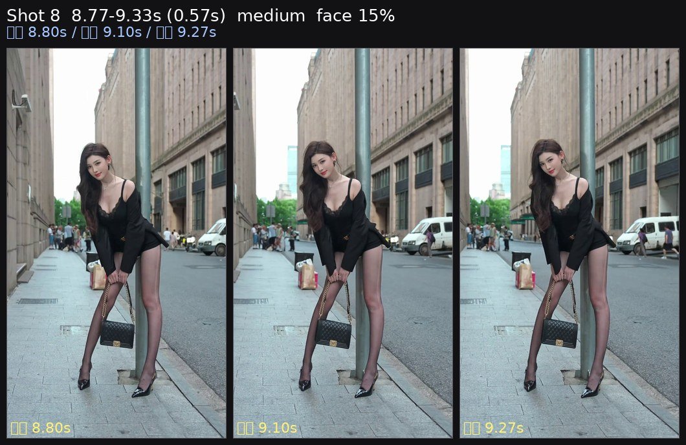
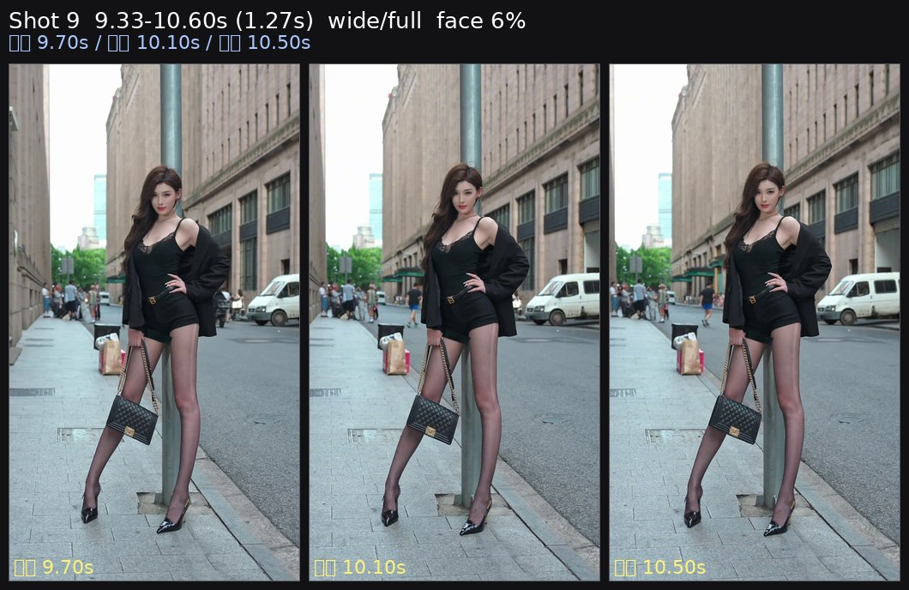

<video src="source.mp4" controls preload="metadata" width="270"></video>

[源视频 source](source.mp4) · 10.6s · 1080×1920 · 30.0fps

# 短视频逐帧拆解：linlin 街拍3

以下数字来自逐帧测量；镜头意图、人物动作和具体器材属于复刻建议。

## 一眼可复刻的配方

| 项目 | 测量结果 | 复刻建议 |
|---|---:|---|
| 时长 / 剪辑 | 10.60s / 9 个镜头 | 保留测得的快切密度和长短交替 |
| 画幅 / 帧率 | 竖幅 9:16，30fps | 维持原画幅；快动作按 1/60 起拍 |
| 镜头长度 | 平均 1.18s | 短镜头用于节奏，较长镜头用于落点 |
| 景别序列 | 宽景/全身、宽景/全身、中景、宽景/全身、中景、中景、宽景/全身、中景、宽景/全身 | 按同一序列复刻，不要把宽景全部拍成近景 |
| 测得脸高 | 7.5%, 7.7%, 8.9%, 7.4%, 8.3%, 12.6%, 6.3%, 14.8%, 6.4% | 按每镜头脸高调整距离；不要只凭焦段猜景别 |
| 面部曝光 | 137/255（54%），+1.6 stops | Rec.709 以脸部 55–60 IRE 为起点 |
| 主体分离 | 脸-背景 +0.15 stops；脸-衣物/头发 +0.67 stops | 先靠亮度和距离分离，不要默认需要强虚化 |
| 光比 / 方向 | key-fill 0.27 stops，右侧更亮帧 80% | 主光固定在画面右侧、靠近镜头轴 |
| 色彩 | chroma 7.6；高饱和区域主色：橙 53%、青绿 28%、黄 8% | 按实测方向调色，避免套用相反色调预设 |
| 节奏 | 99.4 BPM（每拍 0.604s），剪辑点到最近 onset 中位偏差 0.154s，25% 的剪辑点在 ±60ms 内 | 按拍点/乐句剪辑，保留短促标点 |

## 器材未知时的起始设置

| 部分 | 起始设置 |
|---|---|
| 机身 | 竖幅 9:16，30p，快门 1/60 |
| 镜头 | 先用 35mm 全画幅等效；近景按脸高和空间后退/靠近，手机优先用主摄 |
| 光圈 / ISO | f/2.8–f/4 起步；ISO 以脸部斑马/波形校准，不固定套数值 |
| 对焦 | 人脸/眼部 AF；相位响应低或脸框很少的镜头，优先手动锁焦并留安全距离 |
| 稳定器 | 水平移动用 PF，带俯仰用 PTF，强运动进入后落稳用 Lock/高平滑 PTF |
| 灯光 | 90cm 以上柔光箱/窗光；画面右侧、略高于眼睛；从 20–30% 功率开始 |

## 镜头表

| # | 时间 / 时长 | 景别 | 脸高 | 距离变化 | 趋势 | 相位支持的方向 | 相位响应 |
|---:|---|---|---:|---:|---|---|---:|
| 1 | 0.00–1.10s / 1.10s | 宽景/全身 | 7.5% | -3.0% | move->settle | 左移、下压 | 0.88 |
| 2 | 1.10–2.03s / 0.93s | 宽景/全身 | 7.7% | 0.0% | steady | 相位响应低，方向不可靠 | 0.78 |
| 3 | 2.03–2.63s / 0.60s | 中景 | 8.9% | 8.0% | move->settle | 水平/俯仰量很小 | 0.92 |
| 4 | 2.63–4.77s / 2.13s | 宽景/全身 | 7.4% | 8.0% | steady | 相位响应低，方向不可靠 | 0.56 |
| 5 | 4.77–6.00s / 1.23s | 中景 | 8.3% | 43.0% | steady | 相位响应低，方向不可靠 | 0.62 |
| 6 | 6.00–8.17s / 2.17s | 中景 | 12.6% | 39.0% | move->settle | 相位响应低，方向不可靠 | 0.65 |
| 7 | 8.17–8.77s / 0.60s | 宽景/全身 | 6.3% | -3.0% | steady | 相位响应低，方向不可靠 | 0.53 |
| 8 | 8.77–9.33s / 0.57s | 中景 | 14.8% | 127.0% | steady | 相位响应低，方向不可靠 | 0.52 |
| 9 | 9.33–10.60s / 1.27s | 宽景/全身 | 6.4% | 1.0% | move->settle | 相位响应低，方向不可靠 | 0.74 |

## 逐镜头复刻提示

### 镜头 1 · 0.00–1.10s · 宽景/全身



实测：脸高 7.6%→7.4%，距离变化 -3.0%，头部中心 x 51.0%→51.0%、y 33.0%→34.0%；运动趋势 `move->settle`，相位响应 0.88。

可复刻为左移、下压；方向来自全局相位相关，仍需现场取景复核。

| 项目 | 建议 |
|---|---|
| 焦段 / 快门 | 35mm 等效起步 / 1/60；景别以脸高为准 |
| 距离 | 通过脸高对齐；水平全画幅约 3m 的宽景、约 1.5–2.5m 的中近景作为起点 |
| 稳定器 | 依据上表方向选择 PF/PTF；`move→settle` 镜头最后 0.3–0.5s 留稳定尾帧 |
| 关键点 | 先复刻时间长度、景别和落点，再调整人物动作；不要把低响应相位当成确定机位运动 |

### 镜头 2 · 1.10–2.03s · 宽景/全身



实测：脸高 7.7%→7.7%，距离变化 0.0%，头部中心 x 49.0%→47.0%、y 71.0%→71.0%；运动趋势 `steady`，相位响应 0.78。

相位响应低于 0.8，方向不可靠；报告运动量和景别变化即可，不把它写成确定的摇移。

| 项目 | 建议 |
|---|---|
| 焦段 / 快门 | 35mm 等效起步 / 1/60；景别以脸高为准 |
| 距离 | 通过脸高对齐；水平全画幅约 3m 的宽景、约 1.5–2.5m 的中近景作为起点 |
| 稳定器 | 依据上表方向选择 PF/PTF；`move→settle` 镜头最后 0.3–0.5s 留稳定尾帧 |
| 关键点 | 先复刻时间长度、景别和落点，再调整人物动作；不要把低响应相位当成确定机位运动 |

### 镜头 3 · 2.03–2.63s · 中景



实测：脸高 8.9%→9.6%，距离变化 8.0%，头部中心 x 68.0%→69.0%、y 35.0%→35.0%；运动趋势 `move->settle`，相位响应 0.92。

可复刻为水平/俯仰量很小；方向来自全局相位相关，仍需现场取景复核。

| 项目 | 建议 |
|---|---|
| 焦段 / 快门 | 35mm 等效起步 / 1/60；景别以脸高为准 |
| 距离 | 通过脸高对齐；水平全画幅约 3m 的宽景、约 1.5–2.5m 的中近景作为起点 |
| 稳定器 | 依据上表方向选择 PF/PTF；`move→settle` 镜头最后 0.3–0.5s 留稳定尾帧 |
| 关键点 | 先复刻时间长度、景别和落点，再调整人物动作；不要把低响应相位当成确定机位运动 |

### 镜头 4 · 2.63–4.77s · 宽景/全身



实测：脸高 7.0%→7.6%，距离变化 8.0%，头部中心 x 60.0%→43.0%、y 23.0%→24.0%；运动趋势 `steady`，相位响应 0.56。

相位响应低于 0.8，方向不可靠；报告运动量和景别变化即可，不把它写成确定的摇移。

| 项目 | 建议 |
|---|---|
| 焦段 / 快门 | 35mm 等效起步 / 1/60；景别以脸高为准 |
| 距离 | 通过脸高对齐；水平全画幅约 3m 的宽景、约 1.5–2.5m 的中近景作为起点 |
| 稳定器 | 依据上表方向选择 PF/PTF；`move→settle` 镜头最后 0.3–0.5s 留稳定尾帧 |
| 关键点 | 先复刻时间长度、景别和落点，再调整人物动作；不要把低响应相位当成确定机位运动 |

### 镜头 5 · 4.77–6.00s · 中景



实测：脸高 8.2%→11.7%，距离变化 43.0%，头部中心 x 54.0%→78.0%、y 35.0%→79.0%；运动趋势 `steady`，相位响应 0.62。

相位响应低于 0.8，方向不可靠；报告运动量和景别变化即可，不把它写成确定的摇移。

| 项目 | 建议 |
|---|---|
| 焦段 / 快门 | 35mm 等效起步 / 1/60；景别以脸高为准 |
| 距离 | 通过脸高对齐；水平全画幅约 3m 的宽景、约 1.5–2.5m 的中近景作为起点 |
| 稳定器 | 依据上表方向选择 PF/PTF；`move→settle` 镜头最后 0.3–0.5s 留稳定尾帧 |
| 关键点 | 先复刻时间长度、景别和落点，再调整人物动作；不要把低响应相位当成确定机位运动 |

### 镜头 6 · 6.00–8.17s · 中景



实测：脸高 10.8%→15.0%，距离变化 39.0%，头部中心 x 50.0%→49.0%、y 31.0%→28.0%；运动趋势 `move->settle`，相位响应 0.65。

相位响应低于 0.8，方向不可靠；报告运动量和景别变化即可，不把它写成确定的摇移。

| 项目 | 建议 |
|---|---|
| 焦段 / 快门 | 35mm 等效起步 / 1/60；景别以脸高为准 |
| 距离 | 通过脸高对齐；水平全画幅约 3m 的宽景、约 1.5–2.5m 的中近景作为起点 |
| 稳定器 | 依据上表方向选择 PF/PTF；`move→settle` 镜头最后 0.3–0.5s 留稳定尾帧 |
| 关键点 | 先复刻时间长度、景别和落点，再调整人物动作；不要把低响应相位当成确定机位运动 |

### 镜头 7 · 8.17–8.77s · 宽景/全身



实测：脸高 6.4%→6.3%，距离变化 -3.0%，头部中心 x 42.0%→46.0%、y 27.0%→27.0%；运动趋势 `steady`，相位响应 0.53。

相位响应低于 0.8，方向不可靠；报告运动量和景别变化即可，不把它写成确定的摇移。

| 项目 | 建议 |
|---|---|
| 焦段 / 快门 | 35mm 等效起步 / 1/60；景别以脸高为准 |
| 距离 | 通过脸高对齐；水平全画幅约 3m 的宽景、约 1.5–2.5m 的中近景作为起点 |
| 稳定器 | 依据上表方向选择 PF/PTF；`move→settle` 镜头最后 0.3–0.5s 留稳定尾帧 |
| 关键点 | 先复刻时间长度、景别和落点，再调整人物动作；不要把低响应相位当成确定机位运动 |

### 镜头 8 · 8.77–9.33s · 中景



实测：脸高 6.6%→14.9%，距离变化 127.0%，头部中心 x 75.0%→47.0%、y 47.0%→57.0%；运动趋势 `steady`，相位响应 0.52。

相位响应低于 0.8，方向不可靠；报告运动量和景别变化即可，不把它写成确定的摇移。

| 项目 | 建议 |
|---|---|
| 焦段 / 快门 | 35mm 等效起步 / 1/60；景别以脸高为准 |
| 距离 | 通过脸高对齐；水平全画幅约 3m 的宽景、约 1.5–2.5m 的中近景作为起点 |
| 稳定器 | 依据上表方向选择 PF/PTF；`move→settle` 镜头最后 0.3–0.5s 留稳定尾帧 |
| 关键点 | 先复刻时间长度、景别和落点，再调整人物动作；不要把低响应相位当成确定机位运动 |

### 镜头 9 · 9.33–10.60s · 宽景/全身



实测：脸高 6.4%→6.4%，距离变化 1.0%，头部中心 x 53.0%→53.0%、y 26.0%→26.0%；运动趋势 `move->settle`，相位响应 0.74。

相位响应低于 0.8，方向不可靠；报告运动量和景别变化即可，不把它写成确定的摇移。

| 项目 | 建议 |
|---|---|
| 焦段 / 快门 | 35mm 等效起步 / 1/60；景别以脸高为准 |
| 距离 | 通过脸高对齐；水平全画幅约 3m 的宽景、约 1.5–2.5m 的中近景作为起点 |
| 稳定器 | 依据上表方向选择 PF/PTF；`move→settle` 镜头最后 0.3–0.5s 留稳定尾帧 |
| 关键点 | 先复刻时间长度、景别和落点，再调整人物动作；不要把低响应相位当成确定机位运动 |

## 灯光拆解与校准

面部平均 137/255（54%），背景 130/255；主体比背景高 +0.15 stop。左右差 0.27 stop，画面右侧更亮帧占 80%，上下差 +0.08 stop；头发比脸暗 0.98 stop。

```text
环境/背景
    [画面右侧大柔光/窗光]  →  人物  →  摄影机
             略高于眼睛，固定同一侧
```

校准步骤：
1. 按原视频画幅和帧率架位；快门先设为上表值。
2. 主光放在人物画面右侧 30–45°，从 20–30% 功率开始。
3. 调到脸部 55–60 IRE，背景中位比脸低约实测值。
4. 复核左右差和头发暗部；不要为了补亮而把主光换到左侧。
5. 对相位响应高的 `move→settle` 镜头，最后 0.3–0.5s 留稳定尾帧。

## 节奏与调色

音频为 99.4 BPM、每拍 0.604s；镜头长度对应约 1.8、1.6、1.0、3.5、2.0、3.6、1.0、0.9、2.1 拍。剪辑点到 onset 的中位偏差为 0.154s，25% 落在 ±60ms 内。复刻时优先保持短镜头密度和长镜头落点。

整体 chroma 7.6，高饱和区域主色为 橙 53%、青绿 28%、黄 8%。
- 低 chroma 视频：控制饱和度，不要把肤色和环境推得过艳。
- 高光/阴影按测量保留：平均 clip_hi 1.7%，clip_lo 0.0%；不要用大幅 S 曲线覆盖细节。
- 阴影与高光的 Cb/Cr 符号决定色轮方向；若实拍没有对应环境色，先保持中性再轻推。

## 失败模式

| 现象 | 原因/修正 |
|---|---|
| 宽景被拍成近景 | 先锁脸高百分比，再选焦段；不要只按镜头名称判断景别 |
| 运动镜头不稳 | 运动起点和落点没有预留；增加起步前和结束后的稳定尾帧 |
| 左右光感跳变 | 主光换边；固定在画面右侧，填充只做微调 |
| 画面颜色相反 | 参考 grade 的 chroma 和主色，不要套相反的 teal/orange 预设 |
| 低响应镜头被误判为摇移 | 只报告运动量和构图变化，方向留作现场选择 |

## 数据来源

- `.agents/skills/short-video-analysis/scripts/analyze.py all`：probe、cuts、frames、grade、audio、light、shots。
- `.agents/skills/short-video-analysis/scripts/make_strips.py`：代表帧与逐镜头三联条带；单帧镜头使用临时保护副本避免补帧循环，原技能文件未修改。
