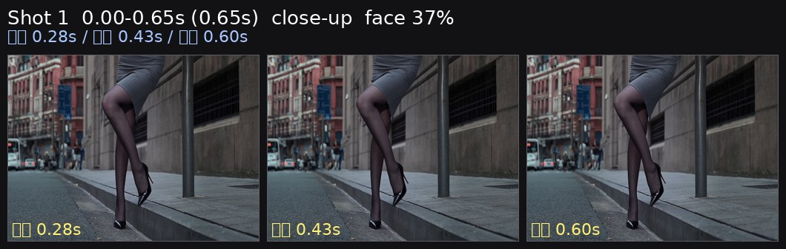
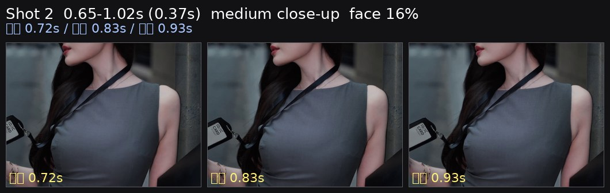
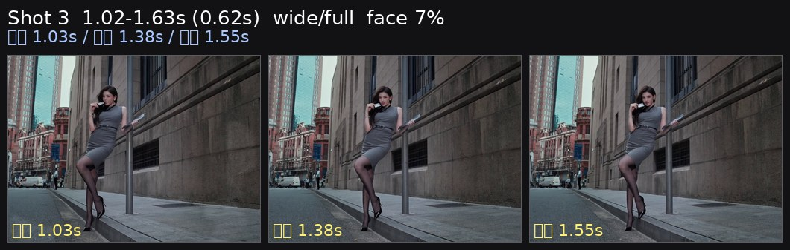
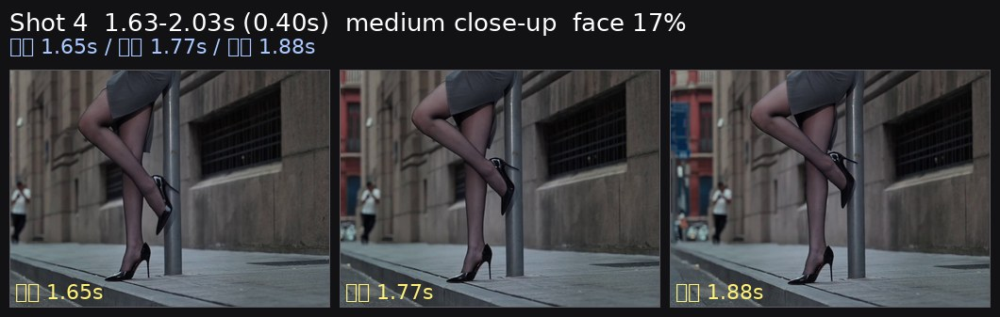
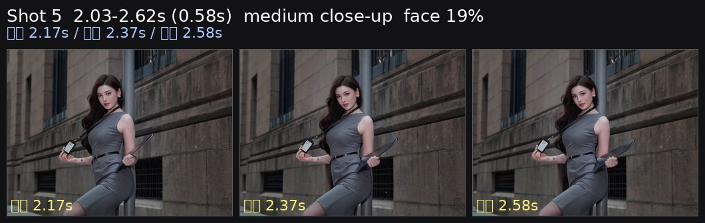
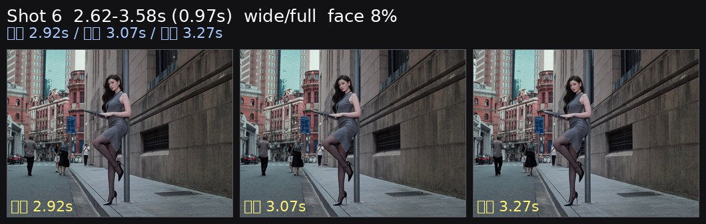
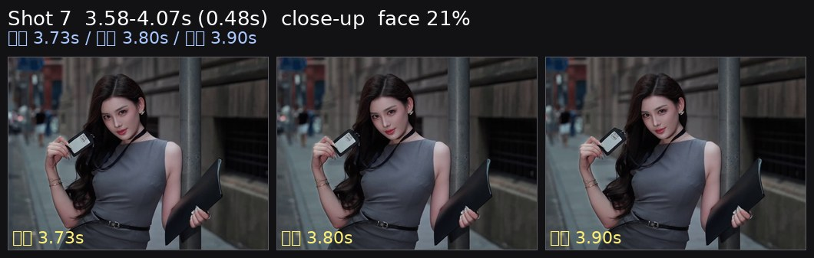
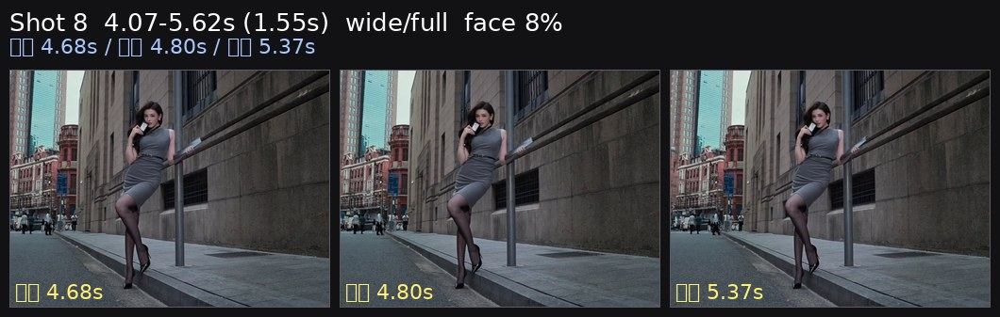
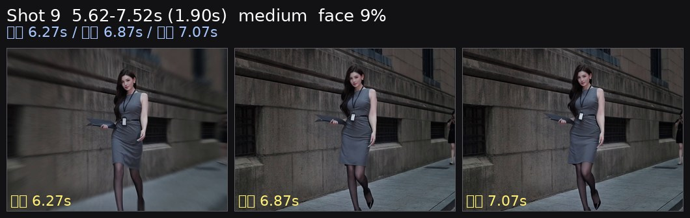
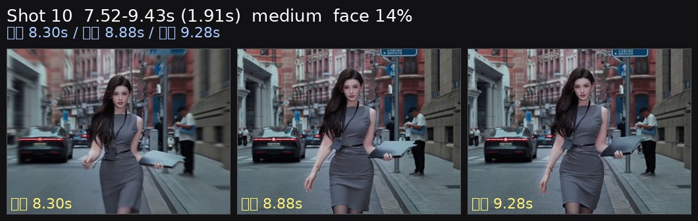

<video src="source.mp4" controls preload="metadata" width="270"></video>

[源视频 source](source.mp4) · 9.4s · 1450×1080 · 60.0fps

# 短视频逐帧拆解：linlin 街拍4

以下数字来自逐帧测量；镜头意图、人物动作和具体器材属于复刻建议。

## 一眼可复刻的配方

| 项目 | 测量结果 | 复刻建议 |
|---|---:|---|
| 时长 / 剪辑 | 9.43s / 10 个镜头 | 保留测得的快切密度和长短交替 |
| 画幅 / 帧率 | 横幅约 4:3（1450×1080），60fps | 维持原画幅；快动作按 1/120 起拍 |
| 镜头长度 | 平均 0.94s | 短镜头用于节奏，较长镜头用于落点 |
| 景别序列 | 近景、中近景、宽景/全身、中近景、中近景、宽景/全身、近景、宽景/全身、中景、中景 | 按同一序列复刻，不要把宽景全部拍成近景 |
| 测得脸高 | 36.6%, 16.2%, 7.3%, 17.3%, 19.0%, 7.5%, 20.9%, 7.5%, 8.7%, 14.5% | 按每镜头脸高调整距离；不要只凭焦段猜景别 |
| 面部曝光 | 117/255（46%），+1.4 stops | Rec.709 以脸部 55–60 IRE 为起点 |
| 主体分离 | 脸-背景 +0.49 stops；脸-衣物/头发 +0.55 stops | 先靠亮度和距离分离，不要默认需要强虚化 |
| 光比 / 方向 | key-fill 0.29 stops，右侧更亮帧 77% | 主光固定在画面右侧、靠近镜头轴 |
| 色彩 | chroma 5.7；高饱和区域主色：橙 39%、青绿 35%、蓝 26% | 按实测方向调色，避免套用相反色调预设 |
| 节奏 | 80.7 BPM（每拍 0.743s），剪辑点到最近 onset 中位偏差 0.066s，44% 的剪辑点在 ±60ms 内 | 按拍点/乐句剪辑，保留短促标点 |

## 器材未知时的起始设置

| 部分 | 起始设置 |
|---|---|
| 机身 | 横幅约 4:3（1450×1080），60p，快门 1/120 |
| 镜头 | 先用 35mm 全画幅等效；近景按脸高和空间后退/靠近，手机优先用主摄 |
| 光圈 / ISO | f/2.8–f/4 起步；ISO 以脸部斑马/波形校准，不固定套数值 |
| 对焦 | 人脸/眼部 AF；相位响应低或脸框很少的镜头，优先手动锁焦并留安全距离 |
| 稳定器 | 水平移动用 PF，带俯仰用 PTF，强运动进入后落稳用 Lock/高平滑 PTF |
| 灯光 | 90cm 以上柔光箱/窗光；画面右侧、略高于眼睛；从 20–30% 功率开始 |

## 镜头表

| # | 时间 / 时长 | 景别 | 脸高 | 距离变化 | 趋势 | 相位支持的方向 | 相位响应 |
|---:|---|---|---:|---:|---|---|---:|
| 1 | 0.00–0.65s / 0.65s | 近景 | 36.6% | -2.0% | move->settle | 右移、上移 | 0.81 |
| 2 | 0.65–1.02s / 0.37s | 中近景 | 16.2% | 4.0% | move->settle | 左移、上移 | 0.93 |
| 3 | 1.02–1.63s / 0.62s | 宽景/全身 | 7.3% | 71.0% | move->settle | 左移 | 0.98 |
| 4 | 1.63–2.03s / 0.40s | 中近景 | 17.3% | -30.0% | steady | 相位响应低，方向不可靠 | 0.70 |
| 5 | 2.03–2.62s / 0.58s | 中近景 | 19.0% | 127.0% | move->settle | 左移、下压 | 0.91 |
| 6 | 2.62–3.58s / 0.97s | 宽景/全身 | 7.5% | -50.0% | move->settle | 水平/俯仰量很小 | 0.95 |
| 7 | 3.58–4.07s / 0.48s | 近景 | 20.9% | -4.0% | steady | 下压 | 0.92 |
| 8 | 4.07–5.62s / 1.55s | 宽景/全身 | 7.5% | -4.0% | move->settle | 左移 | 0.98 |
| 9 | 5.62–7.52s / 1.90s | 中景 | 8.7% | 19.0% | move->settle | 左移、上移 | 0.96 |
| 10 | 7.52–9.43s / 1.91s | 中景 | 14.5% | 23.0% | move->settle | 上移 | 0.94 |

## 逐镜头复刻提示

### 镜头 1 · 0.00–0.65s · 近景



实测：脸高 36.6%→35.8%，距离变化 -2.0%，头部中心 x 64.0%→57.0%、y 66.0%→66.0%；运动趋势 `move->settle`，相位响应 0.81。

可复刻为右移、上移；方向来自全局相位相关，仍需现场取景复核。

| 项目 | 建议 |
|---|---|
| 焦段 / 快门 | 35mm 等效起步 / 1/120；景别以脸高为准 |
| 距离 | 通过脸高对齐；水平全画幅约 3m 的宽景、约 1.5–2.5m 的中近景作为起点 |
| 稳定器 | 依据上表方向选择 PF/PTF；`move→settle` 镜头最后 0.3–0.5s 留稳定尾帧 |
| 关键点 | 先复刻时间长度、景别和落点，再调整人物动作；不要把低响应相位当成确定机位运动 |

### 镜头 2 · 0.65–1.02s · 中近景



实测：脸高 15.6%→16.2%，距离变化 4.0%，头部中心 x 31.0%→36.0%、y 36.0%→36.0%；运动趋势 `move->settle`，相位响应 0.93。

可复刻为左移、上移；方向来自全局相位相关，仍需现场取景复核。

| 项目 | 建议 |
|---|---|
| 焦段 / 快门 | 35mm 等效起步 / 1/120；景别以脸高为准 |
| 距离 | 通过脸高对齐；水平全画幅约 3m 的宽景、约 1.5–2.5m 的中近景作为起点 |
| 稳定器 | 依据上表方向选择 PF/PTF；`move→settle` 镜头最后 0.3–0.5s 留稳定尾帧 |
| 关键点 | 先复刻时间长度、景别和落点，再调整人物动作；不要把低响应相位当成确定机位运动 |

### 镜头 3 · 1.02–1.63s · 宽景/全身



实测：脸高 7.3%→12.4%，距离变化 71.0%，头部中心 x 40.0%→46.0%、y 23.0%→24.0%；运动趋势 `move->settle`，相位响应 0.98。

可复刻为左移；方向来自全局相位相关，仍需现场取景复核。

| 项目 | 建议 |
|---|---|
| 焦段 / 快门 | 35mm 等效起步 / 1/120；景别以脸高为准 |
| 距离 | 通过脸高对齐；水平全画幅约 3m 的宽景、约 1.5–2.5m 的中近景作为起点 |
| 稳定器 | 依据上表方向选择 PF/PTF；`move→settle` 镜头最后 0.3–0.5s 留稳定尾帧 |
| 关键点 | 先复刻时间长度、景别和落点，再调整人物动作；不要把低响应相位当成确定机位运动 |

### 镜头 4 · 1.63–2.03s · 中近景



实测：脸高 19.3%→13.5%，距离变化 -30.0%，头部中心 x 90.0%→67.0%、y 38.0%→50.0%；运动趋势 `steady`，相位响应 0.70。

该镜头标记为 `face rarely detected`，只应作为剪辑标点；不要据此推断人物动作或镜头方向。

| 项目 | 建议 |
|---|---|
| 焦段 / 快门 | 35mm 等效起步 / 1/120；景别以脸高为准 |
| 距离 | 通过脸高对齐；水平全画幅约 3m 的宽景、约 1.5–2.5m 的中近景作为起点 |
| 稳定器 | 依据上表方向选择 PF/PTF；`move→settle` 镜头最后 0.3–0.5s 留稳定尾帧 |
| 关键点 | 先复刻时间长度、景别和落点，再调整人物动作；不要把低响应相位当成确定机位运动 |

### 镜头 5 · 2.03–2.62s · 中近景



实测：脸高 14.5%→33.0%，距离变化 127.0%，头部中心 x 43.0%→69.0%、y 29.0%→52.0%；运动趋势 `move->settle`，相位响应 0.91。

可复刻为左移、下压；方向来自全局相位相关，仍需现场取景复核。

| 项目 | 建议 |
|---|---|
| 焦段 / 快门 | 35mm 等效起步 / 1/120；景别以脸高为准 |
| 距离 | 通过脸高对齐；水平全画幅约 3m 的宽景、约 1.5–2.5m 的中近景作为起点 |
| 稳定器 | 依据上表方向选择 PF/PTF；`move→settle` 镜头最后 0.3–0.5s 留稳定尾帧 |
| 关键点 | 先复刻时间长度、景别和落点，再调整人物动作；不要把低响应相位当成确定机位运动 |

### 镜头 6 · 2.62–3.58s · 宽景/全身



实测：脸高 14.5%→7.3%，距离变化 -50.0%，头部中心 x 32.0%→44.0%、y 16.0%→22.0%；运动趋势 `move->settle`，相位响应 0.95。

可复刻为水平/俯仰量很小；方向来自全局相位相关，仍需现场取景复核。

| 项目 | 建议 |
|---|---|
| 焦段 / 快门 | 35mm 等效起步 / 1/120；景别以脸高为准 |
| 距离 | 通过脸高对齐；水平全画幅约 3m 的宽景、约 1.5–2.5m 的中近景作为起点 |
| 稳定器 | 依据上表方向选择 PF/PTF；`move→settle` 镜头最后 0.3–0.5s 留稳定尾帧 |
| 关键点 | 先复刻时间长度、景别和落点，再调整人物动作；不要把低响应相位当成确定机位运动 |

### 镜头 7 · 3.58–4.07s · 近景



实测：脸高 21.5%→20.7%，距离变化 -4.0%，头部中心 x 42.0%→43.0%、y 33.0%→31.0%；运动趋势 `steady`，相位响应 0.92。

可复刻为下压；方向来自全局相位相关，仍需现场取景复核。

| 项目 | 建议 |
|---|---|
| 焦段 / 快门 | 35mm 等效起步 / 1/120；景别以脸高为准 |
| 距离 | 通过脸高对齐；水平全画幅约 3m 的宽景、约 1.5–2.5m 的中近景作为起点 |
| 稳定器 | 依据上表方向选择 PF/PTF；`move→settle` 镜头最后 0.3–0.5s 留稳定尾帧 |
| 关键点 | 先复刻时间长度、景别和落点，再调整人物动作；不要把低响应相位当成确定机位运动 |

### 镜头 8 · 4.07–5.62s · 宽景/全身



实测：脸高 7.5%→7.3%，距离变化 -4.0%，头部中心 x 40.0%→46.0%、y 20.0%→20.0%；运动趋势 `move->settle`，相位响应 0.98。

可复刻为左移；方向来自全局相位相关，仍需现场取景复核。

| 项目 | 建议 |
|---|---|
| 焦段 / 快门 | 35mm 等效起步 / 1/120；景别以脸高为准 |
| 距离 | 通过脸高对齐；水平全画幅约 3m 的宽景、约 1.5–2.5m 的中近景作为起点 |
| 稳定器 | 依据上表方向选择 PF/PTF；`move→settle` 镜头最后 0.3–0.5s 留稳定尾帧 |
| 关键点 | 先复刻时间长度、景别和落点，再调整人物动作；不要把低响应相位当成确定机位运动 |

### 镜头 9 · 5.62–7.52s · 中景



实测：脸高 7.5%→8.9%，距离变化 19.0%，头部中心 x 53.0%→54.0%、y 20.0%→19.0%；运动趋势 `move->settle`，相位响应 0.96。

可复刻为左移、上移；方向来自全局相位相关，仍需现场取景复核。

| 项目 | 建议 |
|---|---|
| 焦段 / 快门 | 35mm 等效起步 / 1/120；景别以脸高为准 |
| 距离 | 通过脸高对齐；水平全画幅约 3m 的宽景、约 1.5–2.5m 的中近景作为起点 |
| 稳定器 | 依据上表方向选择 PF/PTF；`move→settle` 镜头最后 0.3–0.5s 留稳定尾帧 |
| 关键点 | 先复刻时间长度、景别和落点，再调整人物动作；不要把低响应相位当成确定机位运动 |

### 镜头 10 · 7.52–9.43s · 中景



实测：脸高 12.0%→14.8%，距离变化 23.0%，头部中心 x 51.0%→51.0%、y 29.0%→25.0%；运动趋势 `move->settle`，相位响应 0.94。

可复刻为上移；方向来自全局相位相关，仍需现场取景复核。

| 项目 | 建议 |
|---|---|
| 焦段 / 快门 | 35mm 等效起步 / 1/120；景别以脸高为准 |
| 距离 | 通过脸高对齐；水平全画幅约 3m 的宽景、约 1.5–2.5m 的中近景作为起点 |
| 稳定器 | 依据上表方向选择 PF/PTF；`move→settle` 镜头最后 0.3–0.5s 留稳定尾帧 |
| 关键点 | 先复刻时间长度、景别和落点，再调整人物动作；不要把低响应相位当成确定机位运动 |

## 灯光拆解与校准

面部平均 117/255（46%），背景 74/255；主体比背景高 +0.49 stop。左右差 0.29 stop，画面右侧更亮帧占 77%，上下差 +0.25 stop；头发比脸暗 1.27 stop。

```text
环境/背景
    [画面右侧大柔光/窗光]  →  人物  →  摄影机
             略高于眼睛，固定同一侧
```

校准步骤：
1. 按原视频画幅和帧率架位；快门先设为上表值。
2. 主光放在人物画面右侧 30–45°，从 20–30% 功率开始。
3. 调到脸部 55–60 IRE，背景中位比脸低约实测值。
4. 复核左右差和头发暗部；不要为了补亮而把主光换到左侧。
5. 对相位响应高的 `move→settle` 镜头，最后 0.3–0.5s 留稳定尾帧。

## 节奏与调色

音频为 80.7 BPM、每拍 0.743s；镜头长度对应约 0.9、0.5、0.8、0.5、0.8、1.3、0.7、2.1、2.6、2.6 拍。剪辑点到 onset 的中位偏差为 0.066s，44% 落在 ±60ms 内。复刻时优先保持短镜头密度和长镜头落点。

整体 chroma 5.7，高饱和区域主色为 橙 39%、青绿 35%、蓝 26%。
- 低 chroma 视频：控制饱和度，不要把肤色和环境推得过艳。
- 高光/阴影按测量保留：平均 clip_hi 0.0%，clip_lo 1.8%；不要用大幅 S 曲线覆盖细节。
- 阴影与高光的 Cb/Cr 符号决定色轮方向；若实拍没有对应环境色，先保持中性再轻推。

## 失败模式

| 现象 | 原因/修正 |
|---|---|
| 宽景被拍成近景 | 先锁脸高百分比，再选焦段；不要只按镜头名称判断景别 |
| 运动镜头不稳 | 运动起点和落点没有预留；增加起步前和结束后的稳定尾帧 |
| 左右光感跳变 | 主光换边；固定在画面右侧，填充只做微调 |
| 画面颜色相反 | 参考 grade 的 chroma 和主色，不要套相反的 teal/orange 预设 |
| 低响应镜头被误判为摇移 | 只报告运动量和构图变化，方向留作现场选择 |

## 数据来源

- `.agents/skills/short-video-analysis/scripts/analyze.py all`：probe、cuts、frames、grade、audio、light、shots。
- `.agents/skills/short-video-analysis/scripts/make_strips.py`：代表帧与逐镜头三联条带；单帧镜头使用临时保护副本避免补帧循环，原技能文件未修改。
