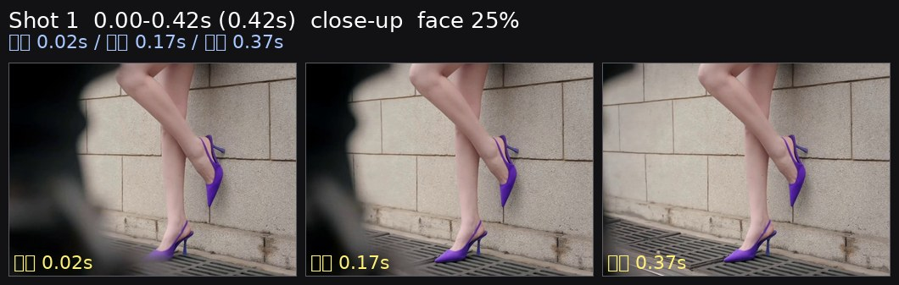
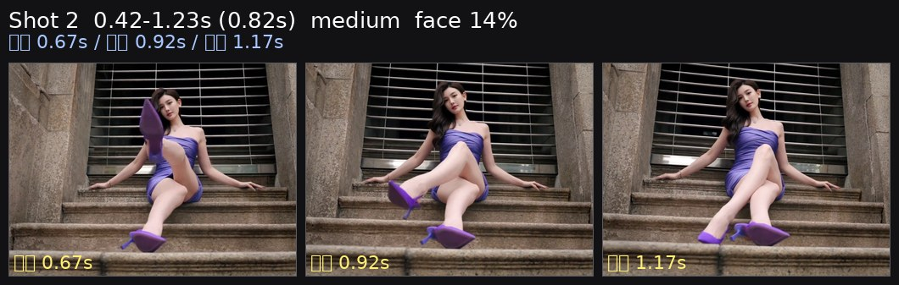
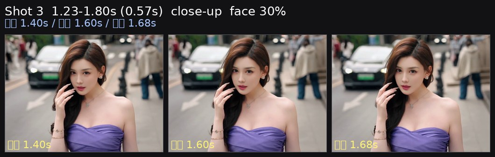
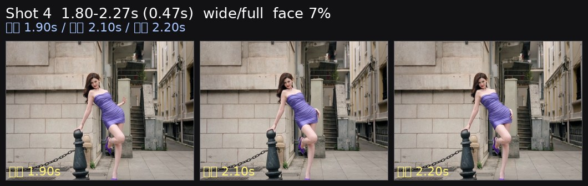
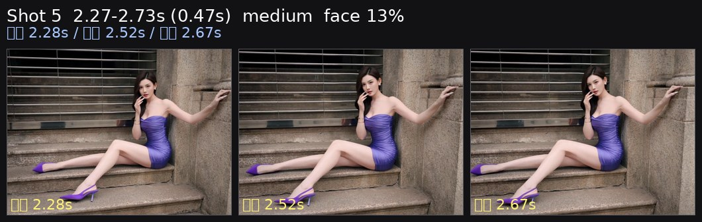
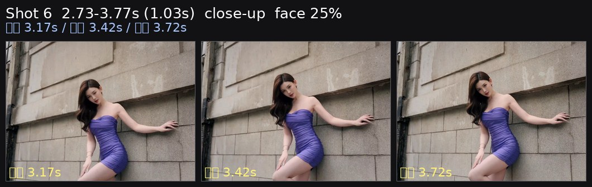
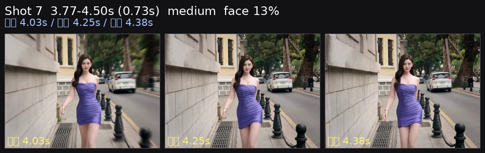
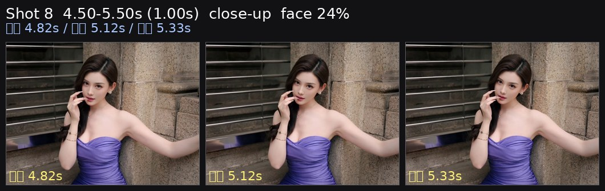
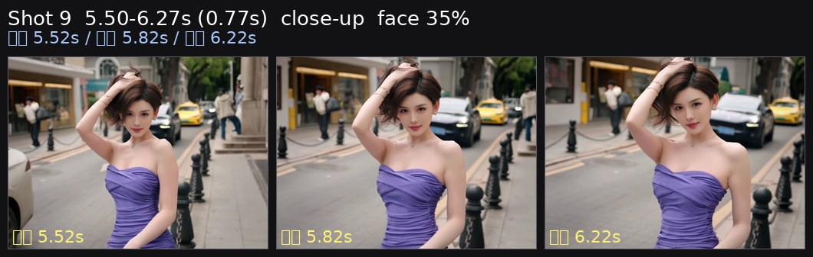
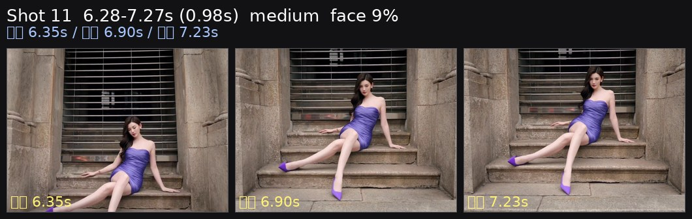

<video src="source.mp4" controls preload="metadata" width="270"></video>

[源视频 source](source.mp4) · 7.3s · 1450×1080 · 60.0fps

# 短视频逐帧拆解：linlin 街拍5

以下数字来自逐帧测量；镜头意图、人物动作和具体器材属于复刻建议。

## 一眼可复刻的配方

| 项目 | 测量结果 | 复刻建议 |
|---|---:|---|
| 时长 / 剪辑 | 7.27s / 11 个镜头 | 保留测得的快切密度和长短交替 |
| 画幅 / 帧率 | 横幅约 4:3（1450×1080），60fps | 维持原画幅；快动作按 1/120 起拍 |
| 镜头长度 | 平均 0.66s | 短镜头用于节奏，较长镜头用于落点 |
| 景别序列 | 近景、中景、近景、宽景/全身、中景、近景、中景、近景、近景、无脸/闪切、中景 | 按同一序列复刻，不要把宽景全部拍成近景 |
| 测得脸高 | 24.9%, 14.1%, 30.0%, 7.4%, 13.0%, 24.9%, 13.0%, 24.3%, 35.3%, 8.7% | 按每镜头脸高调整距离；不要只凭焦段猜景别 |
| 面部曝光 | 148/255（58%），+1.7 stops | Rec.709 以脸部 55–60 IRE 为起点 |
| 主体分离 | 脸-背景 +0.21 stops；脸-衣物/头发 +0.07 stops | 先靠亮度和距离分离，不要默认需要强虚化 |
| 光比 / 方向 | key-fill 0.25 stops，右侧更亮帧 86% | 主光固定在画面右侧、靠近镜头轴 |
| 色彩 | chroma 11.0；高饱和区域主色：蓝 47%、洋红 28%、橙 17% | 按实测方向调色，避免套用相反色调预设 |
| 节奏 | 123.0 BPM（每拍 0.488s），剪辑点到最近 onset 中位偏差 0.074s，40% 的剪辑点在 ±60ms 内 | 按拍点/乐句剪辑，保留短促标点 |

## 器材未知时的起始设置

| 部分 | 起始设置 |
|---|---|
| 机身 | 横幅约 4:3（1450×1080），60p，快门 1/120 |
| 镜头 | 先用 35mm 全画幅等效；近景按脸高和空间后退/靠近，手机优先用主摄 |
| 光圈 / ISO | f/2.8–f/4 起步；ISO 以脸部斑马/波形校准，不固定套数值 |
| 对焦 | 人脸/眼部 AF；相位响应低或脸框很少的镜头，优先手动锁焦并留安全距离 |
| 稳定器 | 水平移动用 PF，带俯仰用 PTF，强运动进入后落稳用 Lock/高平滑 PTF |
| 灯光 | 90cm 以上柔光箱/窗光；画面右侧、略高于眼睛；从 20–30% 功率开始 |

## 镜头表

| # | 时间 / 时长 | 景别 | 脸高 | 距离变化 | 趋势 | 相位支持的方向 | 相位响应 |
|---:|---|---|---:|---:|---|---|---:|
| 1 | 0.00–0.42s / 0.42s | 近景 | 24.9% | 14.0% | settle->move | 右移 | 0.96 |
| 2 | 0.42–1.23s / 0.82s | 中景 | 14.1% | 92.0% | move->settle | 右移、下压 | 0.80 |
| 3 | 1.23–1.80s / 0.57s | 近景 | 30.0% | 10.0% | move->settle | 右移、下压 | 0.97 |
| 4 | 1.80–2.27s / 0.47s | 宽景/全身 | 7.4% | 0.0% | move->settle | 右移 | 0.97 |
| 5 | 2.27–2.73s / 0.47s | 中景 | 13.0% | 20.0% | steady | 右移、下压 | 0.96 |
| 6 | 2.73–3.77s / 1.03s | 近景 | 24.9% | -15.0% | move->settle | 下压 | 0.97 |
| 7 | 3.77–4.50s / 0.73s | 中景 | 13.0% | -40.0% | move->settle | 下压 | 0.97 |
| 8 | 4.50–5.50s / 1.00s | 近景 | 24.3% | -31.0% | move->settle | 左移 | 0.96 |
| 9 | 5.50–6.27s / 0.77s | 近景 | 35.3% | -29.0% | move->settle | 左移、下压 | 0.85 |
| 10 | 6.27–6.28s / 0.02s | 无脸/闪切 | — | — | steady | 相位响应低，方向不可靠 | 0.00 |
| 11 | 6.28–7.27s / 0.98s | 中景 | 8.7% | 0.0% | move->settle | 左移、下压 | 0.98 |

## 逐镜头复刻提示

### 镜头 1 · 0.00–0.42s · 近景



实测：脸高 23.5%→26.8%，距离变化 14.0%，头部中心 x 34.0%→31.0%、y 19.0%→21.0%；运动趋势 `settle->move`，相位响应 0.96。

可复刻为右移；方向来自全局相位相关，仍需现场取景复核。

| 项目 | 建议 |
|---|---|
| 焦段 / 快门 | 35mm 等效起步 / 1/120；景别以脸高为准 |
| 距离 | 通过脸高对齐；水平全画幅约 3m 的宽景、约 1.5–2.5m 的中近景作为起点 |
| 稳定器 | 依据上表方向选择 PF/PTF；`move→settle` 镜头最后 0.3–0.5s 留稳定尾帧 |
| 关键点 | 先复刻时间长度、景别和落点，再调整人物动作；不要把低响应相位当成确定机位运动 |

### 镜头 2 · 0.42–1.23s · 中景



实测：脸高 10.3%→19.8%，距离变化 92.0%，头部中心 x 60.0%→60.0%、y 25.0%→46.0%；运动趋势 `move->settle`，相位响应 0.80。

该镜头标记为 `face rarely detected`，只应作为剪辑标点；不要据此推断人物动作或镜头方向。

| 项目 | 建议 |
|---|---|
| 焦段 / 快门 | 35mm 等效起步 / 1/120；景别以脸高为准 |
| 距离 | 通过脸高对齐；水平全画幅约 3m 的宽景、约 1.5–2.5m 的中近景作为起点 |
| 稳定器 | 依据上表方向选择 PF/PTF；`move→settle` 镜头最后 0.3–0.5s 留稳定尾帧 |
| 关键点 | 先复刻时间长度、景别和落点，再调整人物动作；不要把低响应相位当成确定机位运动 |

### 镜头 3 · 1.23–1.80s · 近景



实测：脸高 28.2%→31.0%，距离变化 10.0%，头部中心 x 49.0%→47.0%、y 37.0%→35.0%；运动趋势 `move->settle`，相位响应 0.97。

可复刻为右移、下压；方向来自全局相位相关，仍需现场取景复核。

| 项目 | 建议 |
|---|---|
| 焦段 / 快门 | 35mm 等效起步 / 1/120；景别以脸高为准 |
| 距离 | 通过脸高对齐；水平全画幅约 3m 的宽景、约 1.5–2.5m 的中近景作为起点 |
| 稳定器 | 依据上表方向选择 PF/PTF；`move→settle` 镜头最后 0.3–0.5s 留稳定尾帧 |
| 关键点 | 先复刻时间长度、景别和落点，再调整人物动作；不要把低响应相位当成确定机位运动 |

### 镜头 4 · 1.80–2.27s · 宽景/全身



实测：脸高 7.5%→7.5%，距离变化 0.0%，头部中心 x 47.0%→47.0%、y 30.0%→31.0%；运动趋势 `move->settle`，相位响应 0.97。

可复刻为右移；方向来自全局相位相关，仍需现场取景复核。

| 项目 | 建议 |
|---|---|
| 焦段 / 快门 | 35mm 等效起步 / 1/120；景别以脸高为准 |
| 距离 | 通过脸高对齐；水平全画幅约 3m 的宽景、约 1.5–2.5m 的中近景作为起点 |
| 稳定器 | 依据上表方向选择 PF/PTF；`move→settle` 镜头最后 0.3–0.5s 留稳定尾帧 |
| 关键点 | 先复刻时间长度、景别和落点，再调整人物动作；不要把低响应相位当成确定机位运动 |

### 镜头 5 · 2.27–2.73s · 中景



实测：脸高 12.6%→15.1%，距离变化 20.0%，头部中心 x 61.0%→57.0%、y 24.0%→21.0%；运动趋势 `steady`，相位响应 0.96。

可复刻为右移、下压；方向来自全局相位相关，仍需现场取景复核。

| 项目 | 建议 |
|---|---|
| 焦段 / 快门 | 35mm 等效起步 / 1/120；景别以脸高为准 |
| 距离 | 通过脸高对齐；水平全画幅约 3m 的宽景、约 1.5–2.5m 的中近景作为起点 |
| 稳定器 | 依据上表方向选择 PF/PTF；`move→settle` 镜头最后 0.3–0.5s 留稳定尾帧 |
| 关键点 | 先复刻时间长度、景别和落点，再调整人物动作；不要把低响应相位当成确定机位运动 |

### 镜头 6 · 2.73–3.77s · 近景



实测：脸高 23.9%→20.4%，距离变化 -15.0%，头部中心 x 35.0%→34.0%、y 78.0%→66.0%；运动趋势 `move->settle`，相位响应 0.97。

该镜头标记为 `face rarely detected`，只应作为剪辑标点；不要据此推断人物动作或镜头方向。

| 项目 | 建议 |
|---|---|
| 焦段 / 快门 | 35mm 等效起步 / 1/120；景别以脸高为准 |
| 距离 | 通过脸高对齐；水平全画幅约 3m 的宽景、约 1.5–2.5m 的中近景作为起点 |
| 稳定器 | 依据上表方向选择 PF/PTF；`move→settle` 镜头最后 0.3–0.5s 留稳定尾帧 |
| 关键点 | 先复刻时间长度、景别和落点，再调整人物动作；不要把低响应相位当成确定机位运动 |

### 镜头 7 · 3.77–4.50s · 中景



实测：脸高 17.6%→10.5%，距离变化 -40.0%，头部中心 x 46.0%→53.0%、y 39.0%→28.0%；运动趋势 `move->settle`，相位响应 0.97。

可复刻为下压；方向来自全局相位相关，仍需现场取景复核。

| 项目 | 建议 |
|---|---|
| 焦段 / 快门 | 35mm 等效起步 / 1/120；景别以脸高为准 |
| 距离 | 通过脸高对齐；水平全画幅约 3m 的宽景、约 1.5–2.5m 的中近景作为起点 |
| 稳定器 | 依据上表方向选择 PF/PTF；`move→settle` 镜头最后 0.3–0.5s 留稳定尾帧 |
| 关键点 | 先复刻时间长度、景别和落点，再调整人物动作；不要把低响应相位当成确定机位运动 |

### 镜头 8 · 4.50–5.50s · 近景



实测：脸高 35.2%→24.3%，距离变化 -31.0%，头部中心 x 46.0%→52.0%、y 75.0%→33.0%；运动趋势 `move->settle`，相位响应 0.96。

可复刻为左移；方向来自全局相位相关，仍需现场取景复核。

| 项目 | 建议 |
|---|---|
| 焦段 / 快门 | 35mm 等效起步 / 1/120；景别以脸高为准 |
| 距离 | 通过脸高对齐；水平全画幅约 3m 的宽景、约 1.5–2.5m 的中近景作为起点 |
| 稳定器 | 依据上表方向选择 PF/PTF；`move→settle` 镜头最后 0.3–0.5s 留稳定尾帧 |
| 关键点 | 先复刻时间长度、景别和落点，再调整人物动作；不要把低响应相位当成确定机位运动 |

### 镜头 9 · 5.50–6.27s · 近景



实测：脸高 35.5%→25.1%，距离变化 -29.0%，头部中心 x 48.0%→53.0%、y 78.0%→65.0%；运动趋势 `move->settle`，相位响应 0.85。

可复刻为左移、下压；方向来自全局相位相关，仍需现场取景复核。

| 项目 | 建议 |
|---|---|
| 焦段 / 快门 | 35mm 等效起步 / 1/120；景别以脸高为准 |
| 距离 | 通过脸高对齐；水平全画幅约 3m 的宽景、约 1.5–2.5m 的中近景作为起点 |
| 稳定器 | 依据上表方向选择 PF/PTF；`move→settle` 镜头最后 0.3–0.5s 留稳定尾帧 |
| 关键点 | 先复刻时间长度、景别和落点，再调整人物动作；不要把低响应相位当成确定机位运动 |

### 镜头 10 · 6.27–6.28s · 无脸/闪切

实测：脸高 —→—，距离变化 —，头部中心 x —→—、y —→—；运动趋势 `steady`，相位响应 0.00。

该镜头标记为 `flash/single-frame`，只应作为剪辑标点；不要据此推断人物动作或镜头方向。

| 项目 | 建议 |
|---|---|
| 焦段 / 快门 | 35mm 等效起步 / 1/120；景别以脸高为准 |
| 距离 | 通过脸高对齐；水平全画幅约 3m 的宽景、约 1.5–2.5m 的中近景作为起点 |
| 稳定器 | 依据上表方向选择 PF/PTF；`move→settle` 镜头最后 0.3–0.5s 留稳定尾帧 |
| 关键点 | 先复刻时间长度、景别和落点，再调整人物动作；不要把低响应相位当成确定机位运动 |

### 镜头 11 · 6.28–7.27s · 中景



实测：脸高 8.7%→8.7%，距离变化 0.0%，头部中心 x 58.0%→59.0%、y 33.0%→21.0%；运动趋势 `move->settle`，相位响应 0.98。

可复刻为左移、下压；方向来自全局相位相关，仍需现场取景复核。

| 项目 | 建议 |
|---|---|
| 焦段 / 快门 | 35mm 等效起步 / 1/120；景别以脸高为准 |
| 距离 | 通过脸高对齐；水平全画幅约 3m 的宽景、约 1.5–2.5m 的中近景作为起点 |
| 稳定器 | 依据上表方向选择 PF/PTF；`move→settle` 镜头最后 0.3–0.5s 留稳定尾帧 |
| 关键点 | 先复刻时间长度、景别和落点，再调整人物动作；不要把低响应相位当成确定机位运动 |

## 灯光拆解与校准

面部平均 148/255（58%），背景 130/255；主体比背景高 +0.21 stop。左右差 0.25 stop，画面右侧更亮帧占 86%，上下差 +0.09 stop；头发比脸暗 1.39 stop。

```text
环境/背景
    [画面右侧大柔光/窗光]  →  人物  →  摄影机
             略高于眼睛，固定同一侧
```

校准步骤：
1. 按原视频画幅和帧率架位；快门先设为上表值。
2. 主光放在人物画面右侧 30–45°，从 20–30% 功率开始。
3. 调到脸部 55–60 IRE，背景中位比脸低约实测值。
4. 复核左右差和头发暗部；不要为了补亮而把主光换到左侧。
5. 对相位响应高的 `move→settle` 镜头，最后 0.3–0.5s 留稳定尾帧。

## 节奏与调色

音频为 123.0 BPM、每拍 0.488s；镜头长度对应约 0.9、1.7、1.2、1.0、1.0、2.1、1.5、2.0、1.6、0.0、2.0 拍。剪辑点到 onset 的中位偏差为 0.074s，40% 落在 ±60ms 内。复刻时优先保持短镜头密度和长镜头落点。

整体 chroma 11.0，高饱和区域主色为 蓝 47%、洋红 28%、橙 17%。
- 低 chroma 视频：控制饱和度，不要把肤色和环境推得过艳。
- 高光/阴影按测量保留：平均 clip_hi 0.0%，clip_lo 3.5%；不要用大幅 S 曲线覆盖细节。
- 阴影与高光的 Cb/Cr 符号决定色轮方向；若实拍没有对应环境色，先保持中性再轻推。

## 失败模式

| 现象 | 原因/修正 |
|---|---|
| 宽景被拍成近景 | 先锁脸高百分比，再选焦段；不要只按镜头名称判断景别 |
| 运动镜头不稳 | 运动起点和落点没有预留；增加起步前和结束后的稳定尾帧 |
| 左右光感跳变 | 主光换边；固定在画面右侧，填充只做微调 |
| 画面颜色相反 | 参考 grade 的 chroma 和主色，不要套相反的 teal/orange 预设 |
| 低响应镜头被误判为摇移 | 只报告运动量和构图变化，方向留作现场选择 |

## 数据来源

- `.agents/skills/short-video-analysis/scripts/analyze.py all`：probe、cuts、frames、grade、audio、light、shots。
- `.agents/skills/short-video-analysis/scripts/make_strips.py`：代表帧与逐镜头三联条带；单帧镜头使用临时保护副本避免补帧循环，原技能文件未修改。
