# 复刻《linlin 街拍8》· 设备级拍摄手册

器材：Sony A7R5 + 24-70mm f/2.8 + DJI RS 5 + 神牛 ML100Bi（100W 双色温）

<video src="样片_linlin街拍8.mp4" controls preload="metadata" width="270"></video>

[样片_linlin街拍8.mp4](样片_linlin街拍8.mp4) · 12.0s · 1080×1920 · 30fps · H.264 · 1.75 Mbps

> 样片实测：12.0 秒 / 1080×1920 竖屏 / 30fps / **12 个镜头，平均 1.0 秒一刀**（最短 0.37s，最长 1.9s）/ 音乐 132.5 BPM，低频能量是高频的 45 倍
> 全部结论来自 361 帧逐帧测量：人脸定位（景别与构图）、相位相关全局运动（机位移动）、亮度/色度直方图（光比与调色）
> 本文引用的素材都在同级目录，用的是相对路径，整个文件夹可以随意搬走：`样片_linlin街拍8.mp4`（源视频）、`分镜帧/`（每镜 3 帧：起幅/中幅/落幅，已自动剔除切点边界帧与动态模糊帧）

---

## 一、样片配方（先记住这 12 个数字）

| 维度 | 实测值 | 你要做到的 |
|---|---|---|
| 镜头数 / 时长 | 12 镜 / 12 秒 | 每镜 0.4–1.9s，平均 2 拍一刀 |
| 景别分布 | 全景 1、中景 9、特写 2 | 脸占画面高：6% / 12% / 21% 三档 |
| 头部位置 | 头顶在画面上 1/4–1/3（中位 29%），水平居中（41–59%） | 竖屏中心构图，头顶只留一点空 |
| 机位运动 | **12/12 镜全都在动**，手持微抖 0.4–1.8% 画面宽/帧 | 每镜都要有运动，但落幅要静 |
| 运动结构 | 6/12 镜是"动→静"，末段运动量降到开头的 1/3 | 起幅带动势、落幅静止 0.3–0.5s |
| 脸 vs 背景 | 脸比背景中位亮 **+0.9 档**；背景最亮处≈脸 | 靠明度差分离主体 |
| 脸 vs 衣服 | 衣服/头发比脸暗 **2 档** | 模特穿深色上装 |
| 脸部光比 | 左右只差 0.07–0.09 档（≈**1:1.1**），额头比下巴亮 0.2–0.5 档 | 大柔光、正面偏上，不要硬侧光 |
| 脸部曝光 | 中位 131/255（53%），比 18% 灰高约 1.5 档 | 斑马线 70 刚好擦过颧骨 |
| 色彩 | 饱和度只有正常的 **1/5**；阴影偏青蓝、高光偏暖橙；黑位压到 0，高光溢出 1.5–2% | 后期降饱和 + 轻青橙 + S 曲线 |
| 光源方位 | 8/12 镜的画面最亮区在**右侧**，多镜顶部也亮 | 光源固定在一侧，全程不换位 |
| 背景虚化 | 脸部清晰度是背景的 **2.8 倍** | 全画幅 f/2.8 天然达标 |

补充：样片没有甩镜转场、没有闪白、没有定格帧，全部是硬切。第 5 镜（0.37s）是一个**完全静止**的插入镜头，作用是把节奏"顿"一下。

---

## 二、全局设备设置

### 2.1 Sony A7R5

| 项目 | 设置 | 原因 |
|---|---|---|
| 拍摄方向 | **机身竖装**（RS5 原生竖拍卡槽） | 见 2.2 的视角换算 |
| 文件格式 | XAVC HS 4K（H.265）10-bit 4:2:2，100M | 竖裁后仍有 2160 宽，够用且省卡 |
| 分辨率/帧率 | 3840×2160 / 30p（或 25p） | 与样片一致；后期建 1080×1920 时间线 |
| 慢动作备选 | 1080p 120fps 或 4K60（Super35 裁切 1.5×） | 只给镜 6、镜 8 用 |
| 快门 | 1/60（30p）；出现 LED 频闪条纹就用"可变快门"微调到 1/55～1/58 | 甩动/走动都要有自然动态模糊 |
| 光圈 | f/2.8（特写/中景），f/4（全景，保证全身在焦内） | 样片背景清晰度只有脸的 1/3 |
| ISO | 800 起，上限 1600（带灯）/ 3200（纯环境光） | R5 高像素，别硬拉 |
| Picture Profile | **PP11 S-Cinetone**（后期只降饱和即可） | 夜景用 S-Log3 会把暗部噪点放大 |
| 白平衡 | **手动 4300K，全片锁定**，禁 AWB | 样片整体偏冷；AWB 会让镜头之间色调跳 |
| 对焦 | AF-C + 广域 + 人脸/眼部识别（人） | 走动镜头全靠它 |
| 斑马线 | 70（+5/-5），看颧骨/额头刚好出现纹路 | 对应样片脸部 53% 亮度 |
| 机身防抖 | SteadyShot **关**或"标准"，**不要用增强/Active** | Active 会额外裁切 1.1× 并与云台打架 |
| 录音 | 关闭 | 后期配乐 |
| 每条录制 | 10–20 秒即可，别长录（R5 会热） | 每镜只用中间 1 秒 |

### 2.2 竖屏视角换算（这一步最容易搞错）

机身竖过来后，画面的**垂直方向用的是传感器 35.9mm 长边**，水平方向只用 20.2mm。所以竖拍时同一个焦距"垂直方向特别广"：

| 焦距 | 垂直视角 | 水平视角 |
|---|---|---|
| 24mm | 74° | 46° |
| 28mm | 65° | 39° |
| 35mm | 54° | 32° |
| 50mm | 40° | 23° |
| 70mm | 29° | 16° |

结论：竖拍时 24mm 已经很广（会拉变形），**人像主力是 35–70mm**；想要样片那种"背景压缩、脸不变形"的特写，用 70mm。

距离对照表（让脸占到指定画面高度，按人脸检测框≈20cm 真实高度估算，误差 ±15%，以取景器为准）：

| 景别 | 脸占画面高 | 24mm | 28mm | 35mm | 50mm | 70mm |
|---|---|---|---|---|---|---|
| 全景（全身） | 6% | 2.2m | 2.6m | 3.3m | 4.6m | 6.5m |
| 中全景（膝上） | 9% | 1.5m | 1.7m | 2.2m | 3.1m | 4.3m |
| 中景（腰上） | 12% | 1.1m | 1.3m | 1.6m | 2.3m | 3.2m |
| 中近景（胸上） | 16% | 0.8m | 1.0m | 1.2m | 1.7m | 2.4m |
| 特写（头肩） | 21% | 0.6m | 0.7m | 0.9m | 1.3m | 1.9m |

### 2.3 DJI RS 5

| 模式 | 行为 | 用在哪 |
|---|---|---|
| **PF**（航向跟随） | 只有水平转向跟随，俯仰/横滚锁定，地平线永远水平 | 纯横摇跟拍：镜 4、7、10 |
| **PTF**（航向+俯仰跟随） | 水平+俯仰跟随，地平线仍水平 | 需要上摇/下摇的镜头：镜 1、8、11、12 |
| **FPV** | 三轴全跟随，手腕倾斜画面就倾斜 | 快速冲近/俯拍等动态镜头：镜 3、9 |
| **锁定**（按住扳机） | 三轴锁死，移动手柄不改变朝向 | 直线推近与完全静止：镜 5、6 |

按键：M 键循环 PF/PTF/FPV；**按住扳机 = 临时锁定**；双击扳机 = 回中；三击扳机 = 180° 翻转。

参数建议：

- 电机力度：中高（A7R5+24-70 约 1.6kg，接近 RS5 负载上限，务必精细调平）
- 跟随平滑度：慢镜 0.6–0.7（镜 1、6、8），快镜 0.3–0.4（镜 3、9）
- **慢摇用摇杆，不要用手腕**：手柄摇杆推动云台转向，比手腕稳一个量级，这是样片"匀速摇镜"的关键
- 变焦后重心会变（24→70 镜身前移），换焦段后重新调平或微调
- 镜 5、6 可以把云台直接放在地上/矮三脚架上，比手持更稳
- 如果你的 RS 5 支持 ActiveTrack（Ronin app + 手机夹），走动跟拍时用它锁人，可以省下摇杆操作

### 2.4 神牛 ML100Bi

| 项目 | 设置 |
|---|---|
| 灯罩 | **90cm 八角/方形柔光箱 + 蛋格（蜂巢）**。首选：面积够大才有样片 1:1.1 的小光比，蛋格控制溢光不污染背景 |
| 备选灯罩 | 60cm 柔光箱（更便携，光稍硬）；**不要用裸灯+标准罩**（样片脸上没有小高光点，皮肤高光面积只有 0.6%，说明是大柔光） |
| 柔光球/灯笼 | 不建议：溢光太大，会把背景一起打亮，破坏"脸比背景亮 0.9 档" |
| 色温 | **4600–4800K**（相机 WB 4300K）→ 脸微暖、背景偏青，正是样片的冷暖分离 |
| 灯位 | 镜头右侧 30–45°、比模特视线高 20–30cm、灯心与脸同高或略高 |
| 距离 | 1.2–2m（越近衰减越快，背景越暗，分离越好） |
| 功率 | 见下表，然后用斑马线校准 |
| 供电 | 外拍用原厂电池手柄/V 口电池；有店家电源就直接插电 |

功率起点（前提：f/2.8、1/60、ISO 800、90cm 柔光箱+蛋格；按平方反比推算，实际以斑马线为准）：

| 灯到人的距离 | 起始功率 | 适用镜头 |
|---|---|---|
| 1.2m | 10% | 特写（镜 8） |
| 1.5m | 15% | 中景（镜 2、4、6、7、11、12） |
| 2.0m | 27% | 中景偏远（镜 1 落幅） |
| 2.5m | 42% | 中全景 |
| 3.0m | 60% | 全景（镜 10 勉强） |
| 4m 以上 | 100% 仍可能不够 | **改用环境光**（见第四节） |

卡口提醒：Godox ML 系列部分型号用专用小卡口、部分用保荣口，请以你手上实物为准；如果是专用卡口就配原厂对应柔光罩或转接环，别硬上第三方柔光箱。

### 2.5 灯光方向必须全程固定

样片 12 个镜头里有 8 个的"画面最亮区"都在右侧，说明拍摄全程光源没有换边。你也要这样：**把灯（或你选的那面橱窗/灯箱）固定在机位右侧 30–45°，模特在它的覆盖范围（1.5–3m）内活动**，不要为了构图让模特走到灯的另一侧——一旦换边，脸的光比和方向就跳了，剪在一起会很脏。

---

## 三、逐镜执行手册（12 镜）

每条实拍录 8–15 秒、拍 3 遍，剪辑只取中间最稳的 1 秒左右。"运动量"是相对指标（帧间平均像素差），用来判断动/静趋势。

### 镜头 1 · 0.00–1.73s · 中景 · 开场

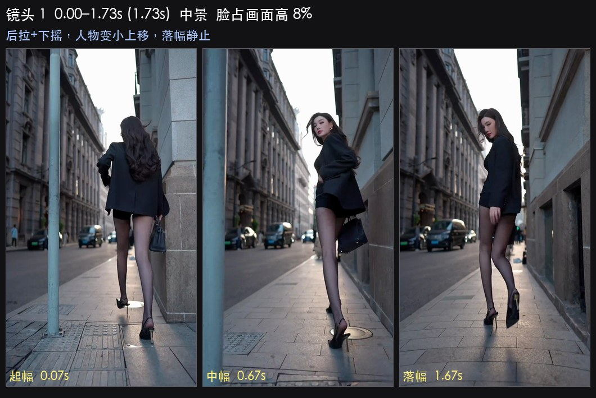

实测：脸占画面高 10.9%→7.5%（人物远离 31%），头顶从画面 71% 升到 23%，运动量 7.7→3.1（动→静），画面最亮区在中右偏上。

| 项目 | 设置 |
|---|---|
| 焦段 | **28mm**（想要更强的空间张力用 24mm） |
| 光圈 / 快门 / ISO | f/2.8 · 1/60 · ISO 800 |
| 距离 | 起 1.7m → 落 2.5m（摄影师后退两小步） |
| 稳定器 | **PTF**，平滑度 0.65，用摇杆做下摇，不要用手腕 |
| 补光 | **开**，15–27%（随距离加），90cm 柔光箱+蛋格，镜头右 30°、高于头 20cm |
| 模特 | 背对/侧对镜头走开两步；或从靠墙姿势转身走开 |
| 要领 | 起幅人物压在画面下 2/3（头顶在 70% 位置），边退边缓慢下摇，让头顶升到上 1/4；**落幅静止 0.5s 再停录** |

### 镜头 2 · 1.73–2.73s · 中景 · 走近

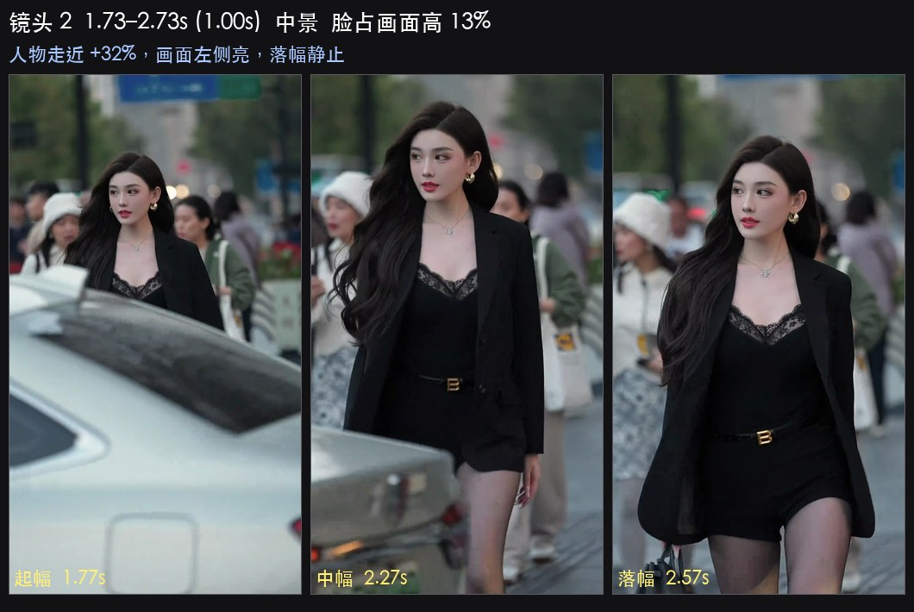

实测：脸 10.6%→14.0%（靠近 32%），头部水平从 39% 移到 48%（回到中心），头顶稳定在 24%，运动量 14.9→9.0（动→静），画面最亮区在左侧偏下。

| 项目 | 设置 |
|---|---|
| 焦段 | **35mm** |
| 光圈 / 快门 / ISO | f/2.8 · 1/60 · ISO 800 |
| 距离 | 起 1.9m → 落 1.4m（模特走近，机位不动） |
| 稳定器 | **PF**（只需轻微横摇修正），平滑度 0.5 |
| 补光 | **开**，15%（模特走近时功率会显得偏强，可预先降到 12%） |
| 模特 | 正面朝镜头走 2–3 步，手插兜或甩包，走到胸上景别时停 |
| 要领 | 头顶全程压在画面上 1/4；用摇杆做 ±5° 的微修正把脸拉回中心；这一镜最亮区在画面左侧，说明环境光在左——**如果你用灯，就把灯放左边，或者接受样片"光位换边"的做法：把亮招牌放进画面左侧当氛围光** |

### 镜头 3 · 2.73–3.53s · 中景 · 冲近擦身

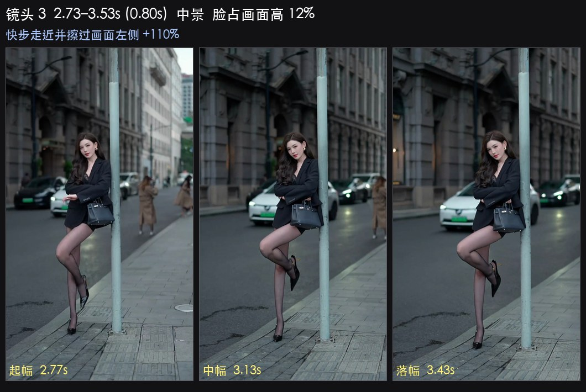

实测：脸 6.7%→14.1%（**靠近 110%**，全片最快的一次距离变化），头部水平从 46% 冲到 14%（擦过画面左边缘），运动量 13.8→9.5（匀速偏快）。

| 项目 | 设置 |
|---|---|
| 焦段 | **24–28mm**（广角才有冲击力） |
| 光圈 / 快门 / ISO | f/2.8 · 1/60 · ISO 1600（广角+快速移动，进光要够） |
| 距离 | 起 3.0m → 落 1.4m |
| 稳定器 | **FPV**，平滑度 0.3（要能快速跟摇）；或干脆手持，允许明显晃动 |
| 果冻控制 | 这一镜运动最快，建议切 **Super35 4K**（裁切 1.5×，24mm≈36mm 视角，果冻更小） |
| 补光 | **开**，起 30%（3m）→ 落 12%（1.4m）；如果调功率来不及，这一镜改用环境光，让模特从亮招牌前走过 |
| 模特 | 快步走向镜头，同时向画面左侧错位擦过，头在最后转向镜头 |
| 要领 | 摄影师要提前把摇杆往左压住，跟着人走；起幅人物在中心，落幅人物在画面最左侧只留半张脸 |

### 镜头 4 · 3.53–4.60s · 中景 · 稳定停留

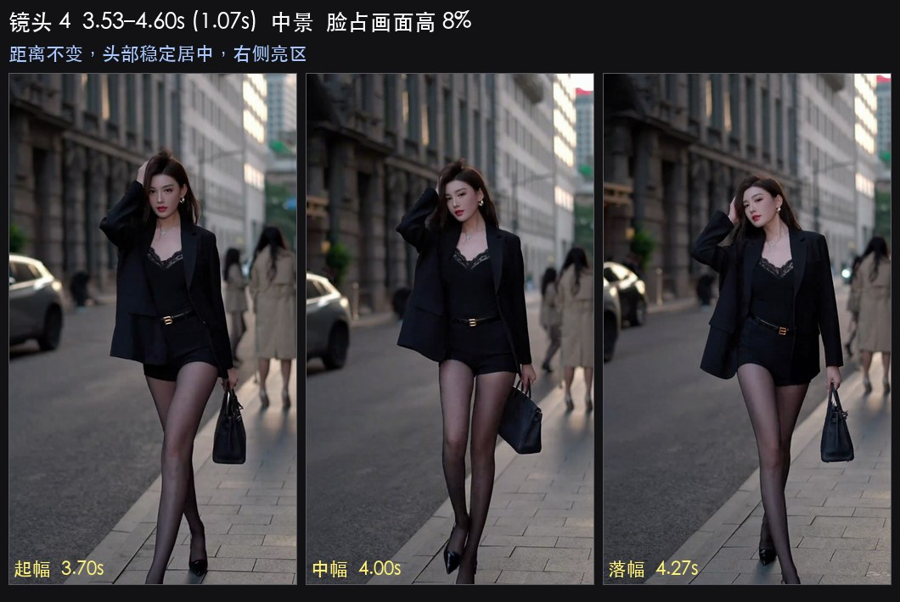

实测：脸 8.4%→8.0%（距离几乎不变），头部水平稳定在 53%、垂直稳定在 26–27%，运动量 8.5→6.7（匀速），画面最亮区在右侧偏顶。

| 项目 | 设置 |
|---|---|
| 焦段 | **35–50mm** |
| 光圈 / 快门 / ISO | f/2.8 · 1/60 · ISO 800 |
| 距离 | 2.3m 全程不变 |
| 稳定器 | **PF**，平滑度 0.6，横移（摄影师侧走两步）而不是摇 |
| 补光 | **开**，27%（2.3m），镜头右 40° |
| 模特 | 停步、抬下巴、整理头发或衣领，动作放慢 |
| 要领 | 这是"呼吸镜头"，构图几乎不动，只有轻微视差；把亮招牌留在画面右侧做背景层次 |

### 镜头 5 · 4.60–4.97s · 中景 · 静止插入（节奏顿点）

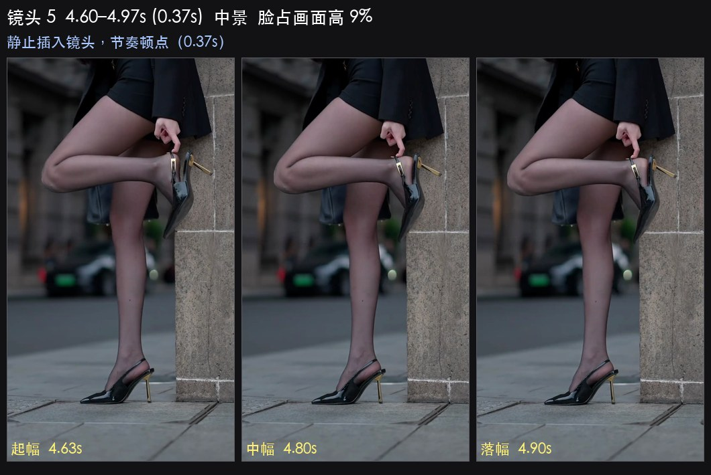

实测：0.37s、11 帧，机位**完全静止**（帧间位移 <1.5px），头顶贴近画面上边缘（8–19%），画面顶部暗、底部亮，主体偏暗（这一镜人物亮度低于背景，接近剪影感）。

| 项目 | 设置 |
|---|---|
| 焦段 | **35mm** |
| 光圈 / 快门 / ISO | f/2.8 · 1/60 · ISO 1600 |
| 距离 | 2.0m 不动 |
| 稳定器 | **锁定模式**（按住扳机），或把 RS5 直接放地上/矮三脚架 |
| 补光 | **可关**（样片这一镜主体偏暗）；想要剪影感就让模特背对光源，只留轮廓 |
| 模特 | 一个静态姿势，或者只做一个小动作（低头、抬手） |
| 要领 | 这一镜的作用是让快节奏"顿一下"，只需 1–2 秒素材；构图故意把头顶压到画面上边缘、下方留大片环境，与前后镜头形成对比 |

### 镜头 6 · 4.97–5.73s · 中景 · 最稳的一镜

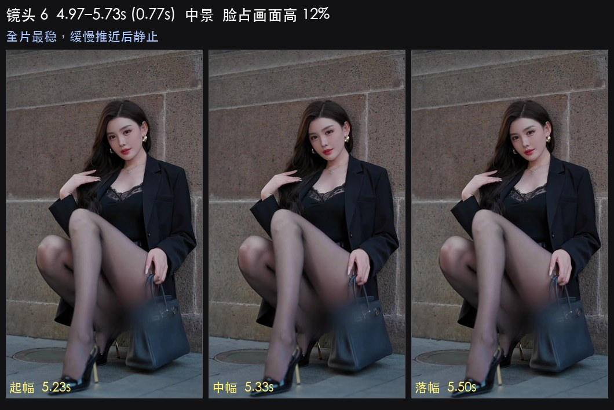

实测：脸 11.7%→12.2%（缓慢靠近 4%），头部几乎不动（水平 59→57%，垂直 25→26%），运动量 4.8→2.0（**全片最静**），画面最亮区在左侧。

| 项目 | 设置 |
|---|---|
| 焦段 | **50mm** |
| 光圈 / 快门 / ISO | f/2.8 · 1/60 · ISO 800 |
| 距离 | 2.3m → 2.2m（身体前倾半步，不要迈大步） |
| 稳定器 | **锁定模式**，靠身体缓慢前移做推镜 |
| 慢动作 | 想更顺滑就 4K60（Super35，50mm≈75mm 视角）拍、放慢到 50% |
| 补光 | **开**，27%，镜头右 30°、高于头 25cm |
| 模特 | 静态 pose，只动眼神和嘴角；不要晃身体 |
| 要领 | 转场后的"落点"镜头，越稳越好；屏住呼吸、双肘夹紧、膝盖微弯走"猫步" |

### 镜头 7 · 5.73–6.93s · 中景 · 跟摇

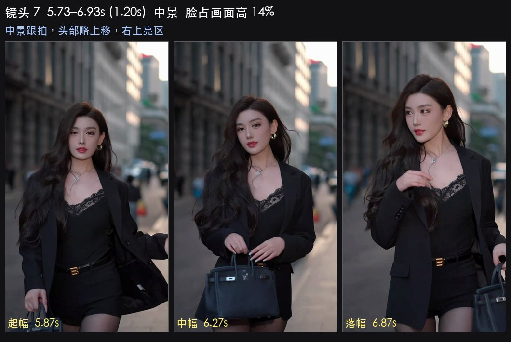

实测：脸 14.1%→14.5%（距离不变），头顶从画面 33% 升到 29%，运动量 6.3→8.2（匀速，后段略快），画面最亮区在右侧偏顶。

| 项目 | 设置 |
|---|---|
| 焦段 | **50mm** |
| 光圈 / 快门 / ISO | f/2.8 · 1/60 · ISO 800 |
| 距离 | 1.9m 全程不变 |
| 稳定器 | **PTF**（有轻微上摇），平滑度 0.55，摇杆操作 |
| 补光 | **开**，20%（1.9m），镜头右 35° |
| 模特 | 原地转身、走半步，或从侧面转成正面 |
| 要领 | 距离不变、只有摇动，所以背景会有明显视差移动——这是样片"高级感"的来源之一；让背景里的亮点光源（招牌）从画面右侧扫过 |

### 镜头 8 · 6.93–8.83s · 特写 · 全片主镜头（最长 1.9s）

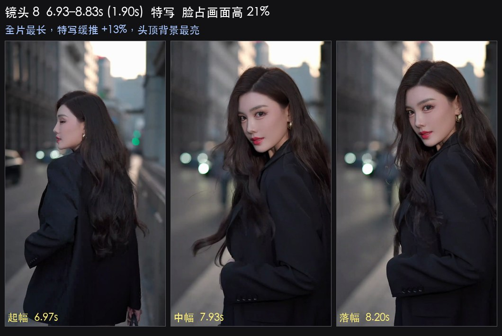

实测：脸 19.1%→21.6%（缓慢推近 13%），头部水平 48%→51%、垂直 31%→32%（几乎不动），运动量 5.5→7.5，画面最亮区在**头顶正上方**（背景亮但脸也亮）。

| 项目 | 设置 |
|---|---|
| 焦段 | **70mm**（脸不变形、背景压缩，最像样片） |
| 光圈 / 快门 / ISO | **f/2.8**（想整张脸都在焦内用 f/4，功率相应加 1 档） · 1/60 · ISO 800 |
| 距离 | 1.9m → 1.7m（缓推半步） |
| 稳定器 | **PTF**，平滑度 0.7、低跟随速度；用摇杆极慢推 |
| 慢动作 | 可选 4K60（Super35，70mm≈105mm 视角，需要站更远：2.8m）放慢到 50% |
| 补光 | **开**，20%（1.9m），90cm 柔光箱+蛋格，镜头右 30°、高于头 25cm；功率宁低勿高，特写会把瑕疵放大 |
| 背景 | 让模特身后 2–3m 有一盏亮点光源（招牌/路灯），亮度调到与脸接近——样片这一镜头顶背景就是全画面最亮的地方 |
| 模特 | 微动作：眨眼、抿嘴、拨头发、下巴微收再抬；每 2–3 秒换一次，不要一直定格 |
| 要领 | 这是全片最长的一镜，也是情绪高点，**至少拍 3 遍选最好的一条**；对焦务必用眼部 AF，70mm/f/2.8 在 1.9m 时景深只有约 ±6cm，模特前后晃就会跑焦 |

### 镜头 9 · 8.83–9.33s · 中景 · 俯拍快切插入

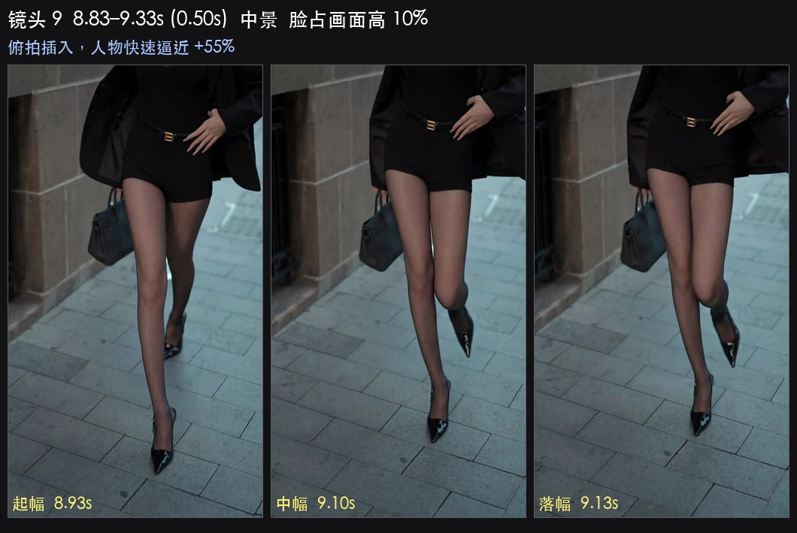

实测：脸 10.2%→15.8%（**快速逼近 55%**），头部在画面右下角（水平 71→73%、垂直 75→85%），0.5s，运动量 7.6 全程匀速。

| 项目 | 设置 |
|---|---|
| 焦段 | **24–35mm**（俯拍要够广才带得下环境） |
| 光圈 / 快门 / ISO | f/2.8 · 1/60 · ISO 1600 |
| 机位高度 | 相机高于模特头顶 40–60cm，向下俯 30–45° |
| 稳定器 | **FPV**（允许画面带倾斜角）；或 PF + 双手把云台往下压 |
| 果冻控制 | 运动快，建议 Super35 4K |
| 补光 | **开**，但要把灯举高到与相机同侧同高（否则俯拍时脸会掉进阴影）；25% 起 |
| 模特 | 抬头看镜头 / 向镜头走近一步 / 回眸 |
| 要领 | 人物放在画面右下而不是中心，与前后镜头形成构图反差；只用 0.5 秒，所以动作要"一眼看懂" |

### 镜头 10 · 9.33–10.03s · 全景 · 展示全身

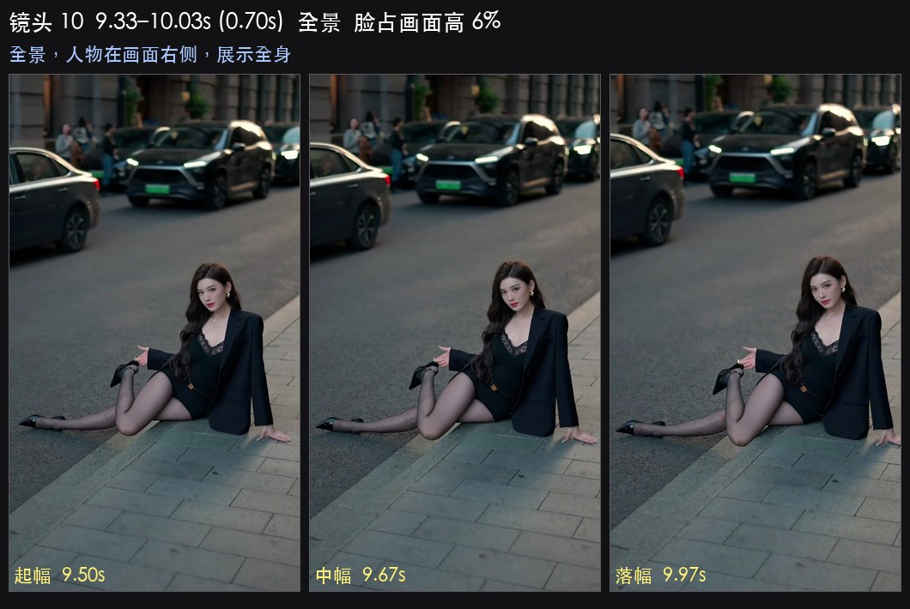

实测：脸仅 5.8–6.4%（全片最小），头部在画面右侧（水平 69→73%）、垂直 42–43%（画面正中偏上），运动量 6.2→4.4，画面最亮区在右下。

| 项目 | 设置 |
|---|---|
| 焦段 | **24mm**（竖拍垂直视角 74°，能装下全身+环境） |
| 光圈 / 快门 / ISO | **f/4**（保证全身清晰） · 1/60 · ISO 1600 |
| 距离 | 3.5–4m |
| 稳定器 | **PF**，摇杆缓慢右摇 |
| 补光 | **建议关**：4m 外 100W 灯加柔光箱已经不够（要 100% 功率且会打亮背景）。这一镜改用**环境光**——让模特站在橱窗/灯箱正前方 1.5–2m，那块亮光就是主光 |
| 模特 | 全身站姿或走位，重心放一条腿，展示服装轮廓 |
| 要领 | 头顶留在画面 42% 高度（不是常规的上 1/3），下方留出腿和地面反光；人物放在画面右侧 2/3 处，左边留给环境 |

### 镜头 11 · 10.03–10.70s · 中景 · 唯一偏彩的一镜

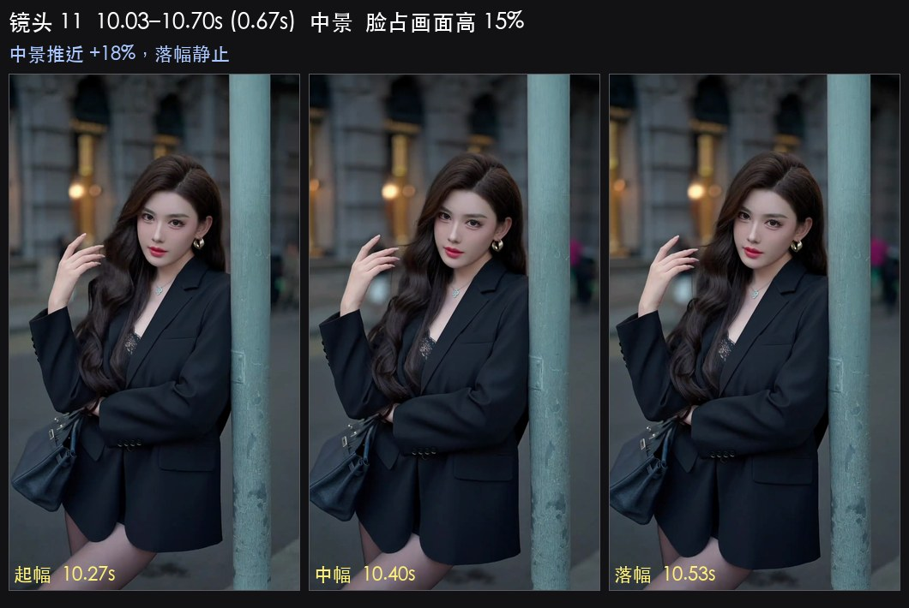

实测：脸 13.3%→15.6%（靠近 18%），头部水平 56→53%、垂直稳定 30%，运动量 9.3→1.4（**动→静最明显的一镜**），画面最亮区在右侧；这一镜的饱和度是全片最高（HSV 饱和度 81 vs 其他镜 45 左右）。

| 项目 | 设置 |
|---|---|
| 焦段 | **35–50mm** |
| 光圈 / 快门 / ISO | f/2.8 · 1/60 · ISO 800 |
| 距离 | 1.9m → 1.6m |
| 稳定器 | **PTF**，平滑度 0.5 |
| 补光 | **开**，20%；**把灯的色温降到 3200–3800K**，让脸偏暖，与背景彩色光形成对比 |
| 环境 | 故意找一个彩色光源（霓虹/彩色招牌/车尾灯）放在画面右侧当背景点缀 |
| 模特 | 侧脸或半转身，最后 0.3s 定住 |
| 要领 | 全片唯一的"色彩呼吸点"，只此一处，别每个镜头都上彩色光；落幅一定要静止（样片末段运动量掉到 1.4） |

### 镜头 12 · 10.70–12.03s · 中景 · 收尾

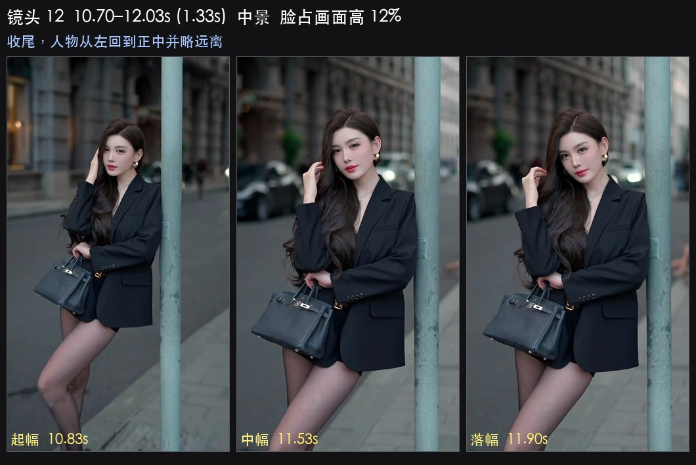

实测：脸 15.6%→12.2%（远离 22%），头部水平从 30% 回到 49%（**从画面左侧回到正中**），垂直 18%→25%，运动量 9.6→2.7（动→静），画面最亮区在右下。

| 项目 | 设置 |
|---|---|
| 焦段 | **35–50mm** |
| 光圈 / 快门 / ISO | f/2.8 · 1/60 · ISO 800 |
| 距离 | 1.6m → 2.0m |
| 稳定器 | **PTF** 起幅 → 落幅时**按住扳机切锁定**，让最后 0.5s 完全稳定 |
| 补光 | **开**，15→27%（随距离增加） |
| 模特 | 从画面左侧走回正中，收在一个定格姿势，最后 0.5s 完全不动 |
| 要领 | 结尾回到中心构图，给观众"结束感"；录够 3 秒静止尾巴，剪辑时留 1 拍余量再出字幕/黑场 |

---

## 四、灯光总方案

### 4.1 样片的光到底是什么样的（测量结果）

```
        大面积柔光（画面右侧 30–45°、略高于视线）
                    ↓  光比仅 1:1.1，皮肤无小高光点 → 光很软
   背景亮点（招牌/路灯）≈ 脸的亮度        脸 131/255（53%）
        背景中位 77/255（30%）  ───►  比脸暗 0.9 档
                    衣服/头发 32–53/255  ───►  比脸暗 2 档
                    黑位压到 0，高光溢出 1.5–2%
```

三个关键结论：

1. **光很软**：左右脸亮度只差 0.07 档，额头比下巴亮 0.24 档，脸上找不到小面积镜面高光（>200 的像素只占 0.6%）。→ 必须是柔光箱/大面积光源，不能是裸灯。
2. **主体靠明度分离，不靠虚化**：脸比背景亮 0.9 档、比衣服亮 2 档。→ 深色衣服 + 只照人不照背景。
3. **背景里有亮点**：背景最亮处（p90=136）和脸（131）一样亮。→ 构图时要把招牌/路灯放进来，画面才不闷。

### 4.2 灯位图

```
            招牌/灯箱（背景亮点，画面右侧或头顶）
                        ▲
                        │ 2–3m
                        │
   [ML100Bi + 90cm 柔光箱 + 蛋格]
        高过头 20–30cm
              ╲ 30–45°
               ╲
                ╲ 1.2–2m
                 ●  模特（深色上装，正对光源）
                 │
                 │ 镜头轴线
                 ▼
            [A7R5 竖装 + RS5]
            摄影师：摇杆操作，双肘夹紧
```

灯和相机在同一侧、夹角 30–45°，这样脸上没有明显鼻影，符合 1:1.1 的光比。**灯不要放到模特正后方**（会剪影），**不要放到正上方**（会有眼袋阴影）。

### 4.3 现场校准流程（5 分钟）

1. 相机切 M 档：1/60、f/2.8、ISO 800、WB 4300K、PP11（S-Cinetone）、斑马线 70。
2. 灯装 90cm 柔光箱+蛋格，色温 4700K，功率先给 15%，放在镜头右 30–45°、高过头 20cm、距离 1.5m。
3. 让模特站到位置，看斑马线：**颧骨/额头刚好出现 70 的斑马纹**就对了。太亮就降功率，太暗就加。
4. 看背景：如果背景被灯照亮了（斑马线也在背景出现），把灯拉近人、加蛋格、或降功率。目标是背景中位亮度只有脸的 60%。
5. 拍一张测试照，回放看直方图：**黑位贴到最左边（允许一小撮死黑），高光不成片溢出**，脸在中间偏右。
6. 记录这一组功率值，之后每次距离变化按平方反比调（距离×1.5 → 功率×2.2）。

### 4.4 三种场景的取舍

| 场景 | 做法 | 适用镜头 |
|---|---|---|
| **A. 自带灯（首选）** | 上面的配置，助手持灯跟着模特走，或灯架固定在"光路"上 | 镜 1–9、11、12 |
| **B. 纯环境光** | 找一面 1×1m 以上的亮光（橱窗/灯箱/LED 屏/加油站），让模特正对它，距离 1.5–3m；相机 ISO 提到 1600–3200 | 镜 10（全景），或全程不想引人注目时 |
| **C. 混合** | 环境亮光当主光，ML100Bi 只补 5–10% 当"眼神光"，从镜头正后方偏 15° 打 | 环境光够亮但脸略脏时 |

街拍带灯架很显眼，实操上最省事的是 **A 的变体**：让助手单手举灯（ML100Bi 加 60cm 柔光箱约 1.5kg），跟着摄影师走，灯始终保持在镜头右侧。

### 4.5 频闪与电源

- LED 低功率调光可能出现 PWM 频闪，在 1/60 快门下表现为滚动条纹。出现就把功率调高一档、用光圈或 ISO 补偿，或用机身"可变快门"微调到 1/55～1/58。
- 电池手柄供电时留意续航：100W 满功率约 1 小时，但我们大部分时间只用 15–30%，能拍一整晚。
- 冬天/低温下电池衰减快，多带一块。

---

## 五、剪辑与调色

### 5.1 剪辑节奏（照抄）

1. 先铺音乐，找鼓点。样片是 132.5 BPM，一拍 0.453 秒。
2. 以 **2 拍（0.9s）一刀**为基准；特写镜头给 4 拍（1.8s），插入镜头给 1 拍（0.45s）。
3. 切点不必严格压在鼓点上（样片中位偏差 0.15 秒 ≈ 1/3 拍），但**间隔要接近整拍倍数**，听感才对。
4. 每条素材只取中间最稳的一段，掐掉起幅和落幅之外的晃动。
5. 节奏骨架：长（1.7）→ 短（1.0/0.8）→ 顿（0.4）→ 稳（0.8）→ 长（1.2/1.9）→ 碎切（0.5/0.7/0.7）→ 收（1.3）。

### 5.2 调色参数（按实测数值调）

| 步骤 | 参数 | 对应实测 |
|---|---|---|
| 1. 饱和度 | 降到 **15–20%** | 样片 chroma 只有 5.9（正常场景 25–40） |
| 2. 分离色调 | 阴影加青蓝、高光加暖橙，**都很轻** | 阴影 Cb +2.5、高光 Cr +1.5 |
| 3. 曲线 | S 曲线，黑位压到 0，暗部拉平 | p0.1 = 0，死黑面积 3.1% |
| 4. 高光 | 保留，允许小面积溢出，不要压 | 高光溢出 1.5–2%，p99.9 = 252 |
| 5. 对比度 | 拉高 | 亮度标准差 48（属高对比） |
| 6. 亮度目标 | 脸 50–55%，背景中位 30% | 脸 131/255、背景 77/255 |
| 7. 锐化/颗粒 | 轻锐化 + 少量颗粒；**暗角不要加** | 样片边缘比中心亮（80.6 vs 63.8） |
| 8. 白平衡 | 已在机内锁 4300K，后期只做微调 | 全片 R-B = -4.5（偏冷） |

用 S-Cinetone 拍的话，第 1、3、5 步就够了；如果用 S-Log3，需要多做一次 LUT 或手动还原。

### 5.3 导出

1080×1920 · 30fps · H.264 · **8–12 Mbps** · AAC 192kbps。平台会再压到 1.7 Mbps 左右，所以源文件不要压太低，也不要指望上传后还有细节——锐化和对比度宁可稍微过一点。

---

## 六、现场清单与翻车点

### 6.1 出发前

- [ ] A7R5 电池 ×3（4K 录制很耗电）、SD 卡 ×2（XAVC HS 4K 100M 约 45 分钟/64G）
- [ ] 24-70 遮光罩、镜头布（夜景招牌会有眩光，遮光罩必装）
- [ ] RS5 充满电、快装板、竖拍校准
- [ ] ML100Bi + 90cm 柔光箱 + 蛋格 + 灯架或助手 + 电池手柄
- [ ] 手机里存好 130–135 BPM 的参考音乐，现场用它对节奏
- [ ] 模特：深色上装（黑/深灰/深蓝），不要大面积印花和亮色（降饱和后会脏）

### 6.2 到场踩点（天黑前 30 分钟）

- [ ] 找到"大柔光"（橱窗/灯箱），确认它在构图右侧
- [ ] 确认模特活动范围内地面平整（要走位、要后退）
- [ ] 找一个背景亮点（招牌/路灯）能进画面的位置，做特写镜头（镜 8）的背景
- [ ] 观察人流：12 个镜头要连续拍 1 小时，避开主干道

### 6.3 常见翻车点

| 症状 | 原因 | 解决 |
|---|---|---|
| 画面像监控录像，没氛围 | 灯功率太高、把背景也照亮了 | 灯拉近人、加蛋格、降功率，背景要暗 0.9 档 |
| 脸很平很假 | 光比太小 + 光太正面 | 灯往侧面多移 10–15°（到 40–45°），保留 0.3–0.5 档的过渡 |
| 脸有明显鼻影/眼袋 | 灯太侧或太高 | 灯回到 30°、降到与眼睛齐平或只高 20cm |
| 镜头之间色调跳 | 用了自动白平衡 | 手动锁 4300K，中途不许改 |
| 特写跑焦 | 70mm/f/2.8 景深只有 ±6cm，模特在晃 | 眼部 AF + 让模特脚尖定住、只动上半身；或收到 f/4 |
| 摇镜一顿一顿 | 用手腕摇 | 改用云台摇杆，平滑度调到 0.6–0.7 |
| 画面有滚动条纹 | LED 频闪 | 提高灯功率、用可变快门微调到 1/55–1/58 |
| 竖拍时画面被裁掉两侧 | 忘了机身是竖装的，用横构图思维取景 | 竖拍垂直视角 74°（24mm），水平只有 46°，横向空间很紧，人物别贴边 |
| 后期发现画面歪 | 竖装后云台没重新校准 | 装好后做一次自动校准，并检查横滚是否水平 |
| 12 个镜头拍成 12 个一样的中景 | 没有按景别分档 | 严格照三档走：全景（脸 6%）2 个、中景（12%）8 个、特写（21%）2 个 |

### 6.4 一个人怎么拍（没有助手）

1. 灯架固定在"光路"上，模特只在灯的覆盖范围（1.5–2.5m）内活动，全程不动灯。
2. 稳定器 + 相机 + 灯都不搬，用焦段变化（24/35/50/70）制造景别差异，而不是靠走位。
3. 每个机位一次拍完同焦段的所有镜头（减少调平次数）。
4. 镜 5、6 这种静止镜头把 RS5 放地上，用遥控/手机 app 触发录制。
5. 没有遥控就用相机的"录制延时启动"或连续录 60 秒长条，后期切段。

### 6.5 拍摄顺序建议（按器材分组，省时间）

| 批次 | 焦段 | 镜头 | 灯功率 |
|---|---|---|---|
| 1 | 70mm | 镜 8（特写主镜头，先拍，状态最好时） | 20% |
| 2 | 50mm | 镜 6、7 | 20–27% |
| 3 | 35mm | 镜 2、4、5、11、12 | 15–27% |
| 4 | 24–28mm | 镜 1、3、9 | 30%（远距离） |
| 5 | 24mm + 环境光 | 镜 10（全景，关灯） | — |

---

## 七、同系列的其他样片

顺手测了同目录另外 9 条，风格高度一致，可以用同一套参数：

| 样片 | 时长 | 镜头数 | 平均镜长 | 脸占画面高 | 画面亮度 | 饱和度 |
|---|---|---|---|---|---|---|
| 街拍8（本手册） | 12.0s | 12 | 1.00s | 12.5% | 77 | 47 |
| 街拍1 | 7.0s | 12 | 0.58s | 9.1% | 100 | 93 |
| 街拍2 | 9.8s | 8 | 1.22s | 9.2% | 84 | 43 |
| 街拍3 | 10.6s | 12 | 0.88s | 8.3% | 122 | 34 |
| 街拍4 | 18.8s | 10 | 1.88s | 8.8% | 76 | 37 |
| 街拍5 | 14.5s | 29 | 0.50s | 10.6% | 116 | 54 |
| 街拍6 | 11.1s | 12 | 0.93s | 9.9% | 113 | 44 |
| 街拍7 | 10.6s | 12 | 0.88s | 8.3% | 122 | 34 |
| 街拍9 | 9.8s | 5 | 1.96s | 8.1% | 90 | 59 |
| 车1 | 7.8s | 11 | 0.71s | 8.9% | 101 | 87 |

共性：8–19 秒、5–29 刀、脸占画面高 8–12%（中景为主）、光比都很小、主光偏画面右侧。街拍8 是这一系列里景别变化最大、特写最长的一条，所以最适合当模板学。

---

*数据来源：逐帧统计（人脸定位、相位相关全局运动、光比与光位、色度分布、音频节奏、景深与亮区分布），中间数据在 `_analysis/`，分镜帧图在 `分镜帧/`。*

*这套分析流程已封装为技能 `short-video-analysis`（`~/.codex/skills/short-video-analysis/`）。以后换一条参考视频，直接说"用 $short-video-analysis 拆解这条视频"即可自动跑完同样的管线并生成同规格的方案。*
